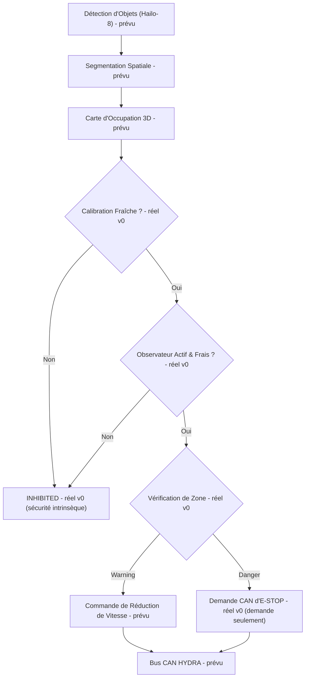

<!-- =============================================================================
HYDRA-UMC-SAFETY-ZONES - Safety zones and E-STOP requests for the Vision AI Node
Copyright (C) JuanenRac (Electro Hobby 3D) <electrohobby3d@gmail.com>
GPL-3.0-or-later - see LICENSE
============================================================================= -->

<p align="center">
  
</p>

# 🛑 HYDRA-UMC-SAFETY-ZONES

<p align="center"><a href="README.md">🇺🇸 English</a> | <a href="README_spa.md">🇪🇸 Español</a> | 🇫🇷 <b>Français</b> | <a href="README_ita.md">🇮🇹 Italiano</a> | <a href="README_deu.md">🇩🇪 Deutsch</a> | <a href="README_zho.md">🇨🇳 简体中文</a> | <a href="README_jpn.md">🇯🇵 日本語</a> | <a href="README_por.md">🇵🇹 Português</a></p>

### 🚨 Logique de violation de zone et de demande d'E-STOP (v0 : pas encore de détecteur ni d'E-STOP physique)

<p align="center">
  
  
  
  
  
  
</p>

---

> **État de la sûreté et de la cybersécurité :** cet écosystème n'est pas un système de sécurité certifié. Il n'existe pas encore de chaîne d'E-STOP matérielle, ni de limites ou de verrouillages imposés par le firmware, ni de commande de mouvement vérifiée ; les images de firmware sont contrôlées par CRC-32 et une signature Ed25519, et une compilation de version refuse les clés de développement publiées (les têtes d'outil et les cartes d'extension derrière le relais utilisent encore les chargeurs d'URTC, qui prennent un HMAC-SHA256 à clé partagée au lieu d'une signature) ; TLS et TLS mutuel sont optionnels et désactivés par défaut ; aucune carte propre n'a encore été assemblée ni testée. Lisez la [base de sécurité](https://github.com/JuanenRac/HYDRA-UMC-DOCS/blob/main/docs/SECURITY_BASELINE.md) et le [modèle de menaces](https://github.com/JuanenRac/HYDRA-UMC-DOCS/blob/main/docs/THREAT_MODEL.md) avant de vous fier à une affirmation d'ici pour la sécurité d'une personne.

---

## 📋 En un coup d'œil

| | |
|---|---|
| Version | `0.1.5` |
| Maturité | Fonctionnel |
| Tests | 248 (`python -m pytest -q tests`) |
| Technologie | Python / 3D vision / Hailo-8 |
| Cible | Le Raspberry Pi CM5 d'une cellule HYDRA-UMC |
| Sur matériel réel | Pas encore : aucune exécution sur du matériel réel n'est consignée pour cette version |

**Aller à :** [Présentation](#-présentation) · [Architecture](#-architecture) · [Sécurité et protection](#-sécurité-et-protection) · [Interfaces](#-interfaces) · [Configuration](#-configuration) · [Démarrage rapide](#-démarrage-rapide) · [Tests](#-tests) · [Dépannage](#-dépannage) · [Structure du dépôt](#-structure-du-dépôt) · [Projets liés](#-projets-liés)

## 🚦 État du projet

Chaque ligne est une partie de ce dépôt et le feu dit où elle en est aujourd'hui. Elle est écrite d'après ce que le dépôt peut montrer (tests, compilations, exécutions), pas d'après ce qui est prévu.

🟢 Fait et vérifié · 🟡 Fonctionne, avec des limites connues · 🟠 À moitié fait ou pas encore vérifié · 🔴 Pas fait ou ne fonctionne pas

| Domaine | État | Ce que cela veut dire ici |
|---|---|---|
| Logiciel | 🟡 | Fonctionne pour son usage principal ; la vérification d'honnêteté ci-dessus liste ce qui manque encore |
| Tests | 🟢 | 248 tests automatiques, exécutés à chaque modification |
| Matériel réel | 🔴 | Pas encore : aucune exécution sur du matériel réel n'est consignée pour cette version |
| Documentation | 🟢 | README en huit langues, vérifié par rapport au manifeste à chaque modification |

## 🎯 Présentation

**HYDRA-UMC-SAFETY-ZONES** est destiné à être le sous-système de sécurité critique de la famille Vision AI Node. Son rôle prévu est de projeter des volumes 3D virtuels autour des robots et de surveiller l'espace de travail pour détecter les intrusions humaines ou objets étrangers, en utilisant la segmentation spatiale haute vitesse du NPU Hailo-8 (prévue : ce pipeline n'existe pas encore) pour détecter les franchissements de zones « Warning » et « Danger » définies.

C'est l'un des 4 enfants de **[HYDRA-UMC-VISION-NODE](https://github.com/JuanenRac/HYDRA-UMC-VISION-NODE)**, le parent d'intégration de la famille, et son entrée de perception est construite sur des modèles compilés par son frère **[HYDRA-UMC-DETECTION-HEF](https://github.com/JuanenRac/HYDRA-UMC-DETECTION-HEF)**.

### Points Clés

* 🚦 **Zones multi-niveaux (v0) :** de vraies définitions `Zone`/`ZoneLevel` (Warning/Danger) sur des volumes 3D alignés sur les axes, et une vraie vérification des franchissements (`check_breaches`) entre un ensemble de zones et un ensemble de positions d'objets détectés.
* 🛑 **Demande d'E-STOP (v0, sans déclenchement) :** tout objet dont le pire franchissement est Danger produit un vrai `EStopRequest`, remis à un `EStopRequester` - voir la frontière de conception ci-dessous pour le pourquoi de ce que rien ici ne déclenche jamais l'arrêt physique lui-même.
* 🔒 **Application de la fraîcheur de calibration (v0) :** chaque ensemble de zones porte une `calibration` optionnelle (version, source, date de calibration, âge maximal en jours). `evaluate_safety()` la vérifie **avant** d'exécuter la moindre logique de franchissement - un ensemble de zones sans calibration du tout, plus ancien que son propre `max_age_days` déclaré, ou daté dans le futur, se résout toujours en `INHIBITED`, sans jamais retomber silencieusement sur `READY` simplement parce qu'aucun objet détecté n'est proche d'une zone.
* 👁️ **Application de la santé de l'observateur (v0) :** `evaluate_safety()` accepte aussi un statut `observation` optionnel (actif/inactif, dernière heure d'observation, propre erreur) - voir [`docs/CLI_REFERENCE.md`](docs/CLI_REFERENCE.md). Aucune évidence d'observation du tout, un observateur désactivé, une erreur signalée par l'observateur, ou une observation obsolète se résolvent tous en `INHIBITED` avant l'exécution de toute logique de franchissement - exactement comme une calibration manquante : un détecteur planté ou un démarrage frais ne doivent jamais être silencieusement lus comme « confirmé dégagé » simplement parce qu'aucun objet n'a été signalé.
* 🧮 **Garde-fou des coordonnées finies (v0) :** `config.py` rejette tout `x`/`y`/`z` `NaN`/`Infinity`/`-Infinity` dans un fichier de zones ou de détections *avant* que `evaluate_safety()` ne s'exécute, se résolvant directement en `INHIBITED` (sortie `3`) plutôt que d'évaluer une frontière avec une coordonnée qui ne peut représenter un point réel.
* 🧱 **Aucun NaN ne désactive une zone, ni dans la bibliothèque ni en bordure :** `Point3D` refuse les coordonnées non finies (un coin NaN rendait `contains()` toujours faux : une zone qui ne se déclenche jamais), `AABB.expanded()` et `velocity_margin_m()` refusent une marge ou une vitesse NaN ou infinie (une vitesse NaN construisait une boîte de NaN autour de chaque zone) et un `DetectedObject` ne peut pas avoir de position NaN. *(implémenté)*
* 🧍 **Les objets ont une étendue :** `DetectedObject.radius_m` (JSON `radiusM`, 0 par défaut) fait d'un objet une sphère : il enfreint toute zone que la sphère touche, si bien qu'une personne dont le centre est hors d'une zone mais dont le bras y pénètre est une infraction (`AABB.intersects_sphere`, inclusif comme `contains()` ; un rayon 0 est exactement l'ancien comportement ponctuel). *(implémenté)*
* 🌐 **API JSON/HTTP (v0.0.7) :** la sous-commande `serve` expose exactement la même logique que `check` (`evaluate_safety()`/`check_breaches()`/`request_estop_for()`) via un `http.server` de la stdlib (`POST /check`, `GET /stats`) pour les appelants autres que la CLI - loopback uniquement par défaut, comme l'unité `systemd/hydra-umc-safety-zones.service`. Voir [`docs/CLI_REFERENCE.md`](docs/CLI_REFERENCE.md) pour chaque commande, flag et code de sortie réel.
* 📏 **Enveloppes de sécurité proportionnelles à la vitesse (v0.1.0, première version bornée) :** `POST /check` accepte un `toolVelocityMps` optionnel (vitesse réelle de la tête/de l'outil, mètres/seconde) - le volume statique de chaque zone grandit alors d'une marge linéaire en cette vitesse (`AABB.expanded()`), plafonnée à un maximum fixe. Le volume statique configuré est toujours le plancher inconditionnel : une vitesse omise ou nulle laisse chaque zone inchangée octet pour octet, et la mise à l'échelle ne peut qu'agrandir une zone, jamais la réduire.
* 📐 **Modèle optionnel de distance de séparation ISO 13855 / ISO 13857 :** un fichier de zones peut déclarer `"separation": {"approach_speed_mps": K, "total_stop_time_s": T, "intrusion_distance_m": C}` (et en option `tool_deceleration_mps2`). Les zones s'agrandissent alors de `S = K·T + C` plus la distance que l'outil parcourt encore pendant l'arrêt de la machine (`v·T`, et `v²/2a` si la décélération est donnée), plafonnée à 10 m. Chaque valeur vient de l'appréciation des risques de la cellule ; rien n'est supposé. La marge linéaire reste le plancher conservateur : le modèle ne peut qu'agrandir une zone, et avec un modèle les zones s'agrandissent même sans vitesse envoyée. *(implémenté, désactivé tant qu'il n'est pas déclaré)*
* 🔐 **Le serveur peut tenir ses propres règles (v0) :** `serve --zones-file PATH` fixe les zones et la calibration sur le serveur (une requête qui envoie ses propres zones est refusée et chaque verdict porte le `configSha256` du fichier) ; `--max-observation-age-seconds` et `--max-calibration-age-days` plafonnent la durée pendant laquelle une requête peut prétendre que ses preuves restent valables ; `--token` / `SAFETY_ZONES_TOKEN` fait exiger un jeton bearer à `POST /check` ; un client qui annonce un corps et n'envoie rien est abandonné après 10 s. Sans `--zones-file`, quiconque atteint le port décide des zones : gardez-le en loopback ou derrière un jeton. NaN et Infinity sont refusés dans toute entrée JSON, une heure sans fuseau horaire est refusée, une cellule sans zones n'est pas acceptée, et tout ce que la CLI ne peut pas lire est `INHIBITED` (sortie `3`), jamais la sortie `1`. *(implémenté)*
* 📐 **Occlusion dynamique (prévu) :** masquer automatiquement la propre structure du robot des déclenchements de sécurité, pour que le robot ne se « détecte » pas lui-même comme une intrusion.
* 🔍 **Détection d'objets étrangers (prévu) :** identifier les outils ou débris laissés dans l'espace de travail.
* 🎥 **Cartographie réelle d'occupation 3D depuis Hailo-8 (prévu) :** le sous-commande `check` de v0 prend les positions d'objets détectés depuis un fichier JSON précisément parce que le vrai pipeline de segmentation spatiale Hailo-8 qui les produirait n'existe pas encore dans cet environnement - voir « Vérification d'honnêteté » ci-dessous.
* 🧩 **Pourquoi c'est un projet séparé :** la logique de sécurité a une barre de vérification différente du reste de la perception - l'isoler dans son propre service permet de la tester, l'auditer et éventuellement la certifier (voir le badge ISO 13849-1 ci-dessus, aspirationnel à ce stade) indépendamment des changements du pipeline caméra ou de la compilation de modèles ailleurs dans la famille.

**Une frontière de conception critique, déjà décidée et désormais renforcée dans le code :** ce projet ne fait que **détecter et demander** un E-STOP - il ne déclenche jamais lui-même le signal d'arrêt physique. Le seul requester réel d'`estop.py`, `NullEStopRequester`, enregistre ce qu'il aurait envoyé sans rien transmettre nulle part - il n'y a pas encore de vrai transport CAN dans ce dépôt, volontairement. Couper réellement l'alimentation moteur via CAN est la responsabilité de [HYDRA-UMC](https://github.com/JuanenRac/HYDRA-UMC) (le firmware), sur du matériel construit pour ce rôle. Garder cette frontière là signifie qu'un bug dans ce service Python peut échouer à *demander* un arrêt, mais ne peut jamais *empêcher* le firmware de l'appliquer indépendamment. Aujourd'hui le firmware n'a aucune trame d'E-STOP à recevoir et `NullEStopRequester` ne transmet rien : cette défense en profondeur est la conception, et n'existe pas encore à l'autre bout.

**Vérification d'honnêteté - ce qui fonctionne réellement aujourd'hui :** le point d'entrée réel (`src/hydra_umc_safety_zones/main.py`) affiche toujours identité/version/rôle sur un appel sans argument, mais dispose désormais aussi d'un vrai sous-commande `check --zones CHEMIN --detections CHEMIN [--observation CHEMIN]` : il charge un ensemble de zones (zones + métadonnées de calibration optionnelles), des positions d'objets détectés et un statut d'observation optionnel depuis JSON, vérifie d'abord la fraîcheur de la calibration, puis la santé de l'observateur (aucun statut d'observation, un observateur désactivé/en erreur/obsolète se résolvent tous en `INHIBITED` exactement comme une calibration manquante), puis exécute une vraie vérification des franchissements, demande des E-STOP pour chaque franchissement Danger, et se termine avec 0 (Ready) / 1 (Warning) / 2 (Danger, E-STOP demandé) / 3 (Inhibited - calibration absente/expirée, ou observateur absent/désactivé/obsolète/en erreur) selon le résultat. Ce qui n'est vraiment pas encore réel : la segmentation spatiale Hailo-8 qui produirait ces positions d'objets détectés sur du matériel réel, le masquage d'auto-occlusion, le vrai processus observateur dont `--observation` signale la vivacité, et tout transport CAN réel pour la demande d'E-STOP. Voir [`CHANGELOG.md`](CHANGELOG.md) pour ce qui a été livré exactement jusqu'à présent, et « État Actuel et Prochaines Étapes » ci-dessous pour ce qui reste ouvert.

## 🧩 Rôle dans HYDRA-UMC

**HYDRA-UMC-SAFETY-ZONES** est le sous-système de sécurité de la famille Vision AI Node : il compare les positions des objets détectés à des volumes d'avertissement et de danger autour des robots et répond READY, WARNING, DANGER ou INHIBITED. Il ne fait que demander un arrêt d'urgence ; l'arrêt physique reste dans le matériel du contrôleur.

## 🏛️ Architecture

<p align="center">
  
</p>

<details>
<summary>Version texte du diagramme (Mermaid)</summary>



</details>

### FLUX DE LOGIQUE DE SÉCURITÉ PRÉVU

Le diagramme ci-dessous est le flux de données cible vers lequel ce projet est construit. `CAL` (vérification de calibration), `OBS` (vérification de santé de l'observateur), `ZONE` (Vérification de Zone) et la répartition Warning/Danger qui suit sont réels aujourd'hui, pilotés par `evaluate_safety()` (qui enveloppe `check_breaches()`/`request_estop_for()`), à partir de positions d'objets détectés lues depuis un fichier JSON. Tout ce qui précède `CAL`/`OBS`/`ZONE` (le vrai pipeline Hailo-8, et le vrai processus observateur dont `OBS` vérifie la vivacité) et suit `STOP` (le vrai transport CAN) reste du travail futur.

### INFORMATIONS TECHNIQUES AVANCÉES

### La frontière détecter-vs-appliquer, et pourquoi elle compte particulièrement ici

De tout ce qui figure dans ce README, c'est la seule décision de conception qui n'est pas qu'un détail d'implémentation : ce service est censé *décider* qu'un arrêt est nécessaire et le *demander* via CAN, mais la coupure physique réelle de l'alimentation moteur se produit sur du matériel à l'intérieur de [HYDRA-UMC](https://github.com/JuanenRac/HYDRA-UMC) construit et certifié pour ce rôle. C'est un choix délibéré de défense en profondeur - un bug logiciel ici (un crash, un blocage, une mauvaise image) dégrade vers « plus aucune nouvelle demande d'arrêt n'est envoyée », pas vers « le matériel de sécurité existant du robot cesse de fonctionner ».

### Pourquoi il n'y a pas de `hardware/`, `firmware/`, `os/` ni `models/` ici

CM5 + Hailo-8 est du matériel existant sur étagère sans carte propre à concevoir, donc - comme le reste de la famille Vision AI Node - aucun dossier `hardware/`/`firmware/` n'existe ici. `os/` (l'image HydraOS partagée) et `models/` (les `.hef` compilés réellement servis au NPU) ne vivent que dans le parent d'intégration, [HYDRA-UMC-VISION-NODE](https://github.com/JuanenRac/HYDRA-UMC-VISION-NODE), car c'est lui qui possède l'image de l'hôte CM5 et le handle du périphérique Hailo-8.

### Décisions de conception déjà prises

* **La version est lue depuis les métadonnées du paquet installé, pas codée en dur** - `main.py` appelle `importlib.metadata.version("hydra-umc-safety-zones")` plutôt qu'une seconde chaîne `__version__`, donc `bump_version.py` n'a qu'un seul endroit à modifier.
* **L'incrément « compteur kilométrique » ne touche automatiquement que `PATCH`/`MINOR`** - `bump_version.py` reporte `PATCH` vers `MINOR` au-delà de 9 et `MINOR` vers `MAJOR` au-delà de 9, mais n'incrémente jamais `MAJOR` lui-même ; même convention que `HYDRA-UMC-EDITOR-URDF/bump_version.py` et `HYDRA-UMC-SUITE/bump_version.py`.
* **Zones AABB, pas des maillages ni des enveloppes convexes** - le volume le plus simple qui permette encore à `check_breaches()` d'être exact et rapide ; un vrai périmètre ressemble très souvent à une boîte en pratique, et une forme plus riche peut être ajoutée plus tard derrière la même interface `Zone`/`AABB.contains()` sans toucher `breach.py` ni `estop.py`.
* **Le confinement de frontière de zone est inclusif, pas exclusif** - `AABB.contains()` traite un point exactement sur le bord comme étant à l'intérieur. Pour un périmètre de sécurité, c'est la direction conservatrice où se tromper : cela ne peut causer qu'un rapport de franchissement plus précoce, jamais un raté.
* **`NullEStopRequester` est le seul requester de ce dépôt** - pas un placeholder en attente d'être remplacé à la légère, mais l'incarnation honnête de la frontière détecter-vs-appliquer elle-même : il n'y a pas de vrai transport CAN ici, et il ne devrait pas non plus y en avoir un ajouté négligemment plus tard (voir « Une frontière de conception critique » ci-dessus et le docstring propre du module `estop.py`).
* **Zones et détections sont du JSON simple, pas du YAML** - la liste de dépendances de `pyproject.toml` reste `[]` ; `json` fait partie de la bibliothèque standard, `pyyaml` est un vrai travail futur une fois qu'il existera un outil d'édition de zones digne d'être sérialisé.
* **La calibration est vérifiée avant toute logique de franchissement, jamais après** - `evaluate_safety()` renvoie `INHIBITED` dès que la calibration est absente ou expirée, avant même d'appeler `check_breaches()`. C'est délibéré : une calibration périmée signifie que la géométrie de zone elle-même n'est pas fiable, donc le résultat d'une vérification de franchissement contre elle serait tout aussi dénué de sens - vérifier la calibration en premier signifie aussi qu'une calibration expirée l'emporte toujours sur ce qui ressemblerait sinon à un vrai franchissement Danger, et non l'inverse.
* **Une clé `"calibration"` absente se charge avec succès, cela signifie juste `INHIBITED`** - `load_zone_set()` ne lève jamais d'erreur simplement parce qu'un fichier de zones est antérieur à cette fonctionnalité ou a été écrit à la main sans métadonnées de calibration ; il échoue de façon sûre par conception au moment de l'évaluation, pas au chargement.
* **`--observation`/`"observation"` est optionnel au niveau de l'interface, pas au niveau de la sécurité** - un appelant qui ne le passe jamais obtient un `INHIBITED` honnête à chaque fois, jamais un plantage et jamais un `READY` silencieux ; cela garde la couche de parsing rétrocompatible pour les appelants pas encore mis à jour tout en fermant la vraie lacune où une liste `objects` vide était indiscernable d'un vrai observateur actif confirmant la cellule dégagée.

## 🔒 Sécurité et protection

| Menace | Défense | Où |
|---|---|---|
| Un étalonnage périmé ou absent laisse une zone muette | `evaluate_safety()` vérifie l'étalonnage avant toute logique d'intrusion et répond INHIBITED s'il manque ou est trop ancien | `calibration.py`, `safety_state.py` |
| Un observateur éteint ou muet fait passer une scène vide pour sûre | Sans preuve d'un observateur actif et récent la réponse est INHIBITED, jamais READY | `observation.py` |
| Un NaN ou un nombre infini crée une zone qui ne se déclenche jamais | `Point3D` et le chargeur JSON refusent les nombres non finis ; la ligne de commande se termine avec le code 3 et INHIBITED | `geometry.py`, `config.py` |
| Un appelant qui desserre le périmètre en envoyant ses propres zones | Avec `--zones-file` le serveur garde lui-même les zones et refuse une requête qui apporte les siennes ; un jeton Bearer (`SAFETY_ZONES_TOKEN`) est comparé en temps constant, les corps s'arrêtent à 1 MiB et 32 connexions sont servies à la fois | `api.py`, `main.py` |

**Ce qu'il ne fait jamais :** déclencher l'arrêt physique ou annoncer READY sur une supposition.

## 🔌 Interfaces

`serve --decision-log FICHIER` (ou `SAFETY_ZONES_DECISION_LOG` ; `-` pour la sortie d'erreur) écrit une ligne JSON par verdict de `POST /check` avec l'heure, l'état, la raison, le hachage de la configuration et le nombre de franchissements et de demandes d'arrêt. Désactivé sauf demande, et un journal qui ne peut pas être écrit ne change jamais le verdict.

`GET /state` (même jeton que `POST /check`) renvoie le dernier verdict sous forme de SafetyState du SDK avec l'heure à laquelle il a été rendu, ou `404` avant le premier ; un consommateur comme le service d'asservissement visuel le lit au lieu de croire ce que dit un appelant. Il n'est gardé qu'en mémoire.

## ⚙️ Configuration

Le service HTTP se règle par options ; deux d'entre elles peuvent aussi venir de l'environnement.

| Variable | Par défaut | Ce qu'elle définit |
|---|---|---|
| `--addr` | `127.0.0.1` | adresse sur laquelle l'API écoute |
| `--port` | `8108` | port de l'API |
| `--zones-file` / `SAFETY_ZONES_FILE` | aucun | zones et étalonnage que le serveur garde fixes |
| `--token` / `SAFETY_ZONES_TOKEN` | aucun | jeton Bearer exigé par POST /check |
| `--max-observation-age-seconds` | aucun | plafond de l'âge qu'une requête peut déclarer pour son observation |
| `--max-calibration-age-days` | aucun | plafond de l'âge maximal de l'étalonnage en jours |

## 🚀 Démarrage rapide

Nécessite Python 3.10 ou plus récent.

```bash
./build.sh  # Linux, macOS (build.bat on Windows)
./run.sh
./run.sh check --zones zones.json --detections detections.json --observation observation.json
./run.sh serve --zones-file zones.json --port 8108
```

## 🧪 Tests

248 tests automatiques s'exécutent avec `python -m pytest -q tests`. Ils n'ont besoin ni de matériel ni de rien en dehors de cette machine.

La CI exécute `HYDRA_UMC_CI=1 python tools/ci_validate.py`, qui vérifie le manifeste, les documents, les huit README et les images.

## 🏗️ Compilation et publication

### Prérequis

* **Python 3.10 ou plus récent** sur le `PATH` (les scripts essaient `python3` puis se replient sur `python`).
* Aucune dépendance runtime de sécurité/vision n'est requise pour l'instant - **zéro dépendance tierce à l'exécution** à ce stade (`dependencies = []` dans `pyproject.toml`) ; `pytest` est un extra de développement uniquement, utilisé exclusivement pour la vraie suite de tests.
* Quelques dizaines de Mo d'espace disque pour un environnement virtuel local sous `.venv/`.

### Étape par étape

```bash
# Linux / macOS
./build.sh
```

1. **Lecture de la version** - lit et affiche la version du projet ; compiler ne la change jamais (seule `python tools/hydra_project_tool.py bump` la fait monter).
2. **Environnement virtuel** - crée `.venv/` s'il manque ; le réutilise sinon.
3. **Installation éditable (avec extras dev)** - `pip install -e ".[dev]"` pour que les modifications sous `src/` prennent effet immédiatement, installe `pytest`, et enregistre le point d'entrée console `hydra-umc-safety-zones`.
4. **Compile-check** - `python -m compileall -q src` compile en bytecode chaque fichier sous `src/`.
5. **Vraie suite de tests** - `pytest tests/` exécute les 248 tests.

`set -euo pipefail` arrête le script à la première étape en échec ; la fenêtre reste ouverte (`Press Enter to close...`) si elle a été lancée par double-clic plutôt que depuis un terminal déjà ouvert.

```bash
./run.sh
```

Localise l'interpréteur dans `.venv` et exécute `python -m hydra_umc_safety_zones.main`, en relayant tout argument.

L'appel sans argument affiche nom + version + rôle :

```text
HYDRA-UMC-SAFETY-ZONES v0.1.5
Real-time 3D intrusion detection and E-STOP orchestration for robotic safe-working areas.
```

Le vrai sous-commande `check` a besoin d'un fichier de zones et d'un fichier de détections, tous deux en JSON simple, plus un fichier de statut d'observation optionnel. `calibration` est optionnel dans le fichier de zones, et `--observation` est optionnel en ligne de commande - voir ci-dessous ce qui se passe sans eux :

```json
// zones.json
{
  "calibration": {"version": "cal-1", "source": "manual", "calibrated_at": "2024-01-15", "max_age_days": 30, "calibrated_by": "A. Operator"},
  "zones": [
    {"id": "warn1", "level": "warning", "min": {"x": 0, "y": 0, "z": 0}, "max": {"x": 5, "y": 5, "z": 5}},
    {"id": "danger1", "level": "danger", "min": {"x": 0, "y": 0, "z": 0}, "max": {"x": 1, "y": 1, "z": 1}}
  ]
}
```

```json
// detections.json
{"objects": [{"id": "op1", "position": {"x": 0.5, "y": 0.5, "z": 0.5}}]}
```

```json
// observation.json - vraie évidence que les détections ci-dessus proviennent
// vraiment d'un observateur actif et récemment mis à jour
{"active": true, "observedAt": "2024-01-15T12:00:00Z", "maxAgeSeconds": 5}
```

Les dates de ces exemples ne sont que des exemples : `calibrated_at` doit être assez récent pour `max_age_days`, et `observedAt` doit se situer dans les `maxAgeSeconds` avant maintenant (avec un fuseau horaire, par exemple un `Z` final) ; avec les dates affichées, le résultat aujourd'hui est `INHIBITED`, et non le `DANGER` ci-dessous.

```bash
./run.sh check --zones zones.json --detections detections.json --observation observation.json
```

```text
SAFETY STATE: DANGER - object(s) ['op1'] breached a danger zone
BREACH: object 'op1' inside warning zone 'warn1'
BREACH: object 'op1' inside danger zone 'danger1'
E-STOP REQUESTED: object 'op1' breached danger zone 'danger1' (not asserted - see estop.py)
```

Se termine avec `2` (Danger, E-STOP demandé), `1` (franchissement Warning seulement), `0` (aucun franchissement, calibration valide, observateur actif et frais), ou `3` (**Inhibited** - calibration absente/expirée, ou observateur absent/désactivé/obsolète/en erreur, vérifiée avant toute logique de franchissement). Exemple réel du chemin de sécurité intrinsèque - les mêmes `detections.json` ci-dessus, mais `zones.json` sans aucune clé `"calibration"` :

```bash
./run.sh check --zones zones_no_calibration.json --detections detections.json --observation observation.json
```

```text
SAFETY STATE: INHIBITED - no calibration metadata present - zone geometry cannot be trusted
```

Sortie `3` - notez qu'il n'y a aucune sortie `BREACH`/`E-STOP` du tout, même si `op1` se trouve à l'intérieur des deux zones : un ensemble de zones non fiable n'atteint jamais l'étape de vérification des franchissements. Omettre entièrement `--observation` échoue de la même façon sûre, même avec une calibration fraîche et aucun objet proche d'une zone :

```bash
./run.sh check --zones zones.json --detections detections_clear.json
```

```text
SAFETY STATE: INHIBITED - no observation status provided - cannot confirm the supplied detections reflect a real, active observer
```

```bat
:: Windows - mêmes étapes, syntaxe batch
build.bat
run.bat
run.bat check --zones zones.json --detections detections.json --observation observation.json
```

La même logique `check` est aussi accessible en HTTP, pour les appelants autres que la CLI - `zones`/`detections`/`observation` voyagent dans le corps JSON plutôt qu'un chemin de fichier :

```bash
./run.sh serve --addr 127.0.0.1 --port 8108
# dans un autre terminal :
curl -s -X POST http://127.0.0.1:8108/check -d '{"zones": {...}, "detections": {...}, "observation": {...}}'
```

Voir [`docs/CLI_REFERENCE.md`](docs/CLI_REFERENCE.md) pour la référence complète des commandes, flags et codes de sortie, incluant chaque état réel (`READY`/`WARNING`/`DANGER`/`INHIBITED`) capturé lors d'une exécution réelle.

### Dépannage

* **`python`/`python3` introuvable** - installez Python 3.10+ et assurez-vous qu'il est sur le `PATH`.
* **`compileall` échoue** - une vraie erreur de syntaxe a été introduite sous `src/` ; le build s'arrête sans toucher à l'installation, volontairement.
* **« No `.venv` found » depuis `run.sh`/`run.bat`** - exécutez `build.sh`/`build.bat` au moins une fois avant.
* **Installation éditable obsolète** - supprimez `.venv/` et reconstruisez ; rarement nécessaire.
* **`check` se termine avec un code non nul** - c'est un comportement réel et correct, pas un échec : `1` signifie qu'un franchissement Warning seulement a été trouvé, `2` signifie qu'un franchissement Danger a demandé un E-STOP, `3` signifie que la calibration de l'ensemble de zones est absente/expirée ou que le statut de l'observateur est absent/désactivé/obsolète/en erreur (sécurité intrinsèque, vérifiée avant que toute logique de franchissement ne s'exécute). Seul un traceback Python ou une erreur de JSON malformé est un vrai bug.

## 🩺 Dépannage

| Vous voyez | Parce que | Faites |
|---|---|---|
| `SAFETY STATE: INHIBITED` + exit code 3 | L'étalonnage ou l'observation manque ou est trop ancien, ou un nombre des fichiers n'est pas fini | Lisez le message, renouvelez l'étalonnage ou le fichier d'observation et relancez `check` |
| HTTP 401 | Le serveur a un jeton et la requête n'en a pas ou un faux | Envoyez `Authorization: Bearer <token>` |

## 📂 Structure du dépôt

<p align="center">
  
</p>

<details>
<summary>Version texte de l'arborescence</summary>

```text
HYDRA-UMC-SAFETY-ZONES/
├── src/hydra_umc_safety_zones/   code source
│   ├── __init__.py               Description et version du paquet
│   ├── geometry.py               Vraies primitives Point3D/AABB
│   ├── zones.py                  Vraies définitions ZoneLevel/Zone/ZoneSet
│   ├── breach.py                 Vraie vérification des franchissements de zone
│   ├── calibration.py            Vrai suivi de la fraîcheur de calibration
│   ├── observation.py            Vrai suivi de la santé de l'observateur - reflète calibration.py
│   ├── safety_state.py           Vraie décision de sécurité intrinsèque : READY/WARNING/DANGER/INHIBITED
│   ├── estop.py                  Vraie demande d'E-STOP (jamais de déclenchement)
│   ├── config.py                 Vrai chargement JSON pour zones/détections/observation
│   ├── api.py                    Surface JSON/HTTP simple (http.server de stdlib) sur la vraie logique `check`
│   └── main.py                   Point d'entrée + vrai sous-commande `check`
├── tests/                        Vrais tests : géométrie, franchissements, calibration, observation, safety_state, estop, config, api, CLI
├── docs/                         Documentation et normes de sécurité
├── images/                       Médias et diagrammes
├── systemd/                      unité de service
├── tools/                        outils du projet et vérifications de la CI
├── .github/                      workflow de CI et modèles de tickets
├── pyproject.toml                Métadonnées du paquet, dépendances, version compteur kilométrique
├── bump_version.py               Incrément de version type compteur kilométrique (exécuté seulement par la commande `bump` explicite)
├── bump_manifest_version.py      Synchronise la version de hydra-umc.project.json avec la version native (--sync)
├── build.sh / build.bat          venv + installation éditable (extras dev) + compile-check + tests
├── run.sh / run.bat              Exécute le point d'entrée depuis le venv local (relaie les arguments)
├── CHANGELOG.md                  Historique version par version (schéma compteur kilométrique, sans dates)
├── Dockerfile                    image de conteneur
├── build-test.sh                 vérification de build sans modification
├── hydra-umc.project.json        manifeste : version, maturité, famille
└── test.sh                       lance les tests
```

</details>

## 🗺️ Feuille de route et limites connues

**Limites connues aujourd'hui**

**Ce qui fonctionne aujourd'hui :** de vraies définitions de zones Warning/Danger et une vraie vérification des franchissements (`geometry.py`/`zones.py`/`breach.py`), une vraie application de la fraîcheur de calibration qui échoue de façon sûre vers `INHIBITED` avant toute logique de franchissement (`calibration.py`/`safety_state.py`), un vrai pipeline de *demande* d'E-STOP qui respecte la frontière détecter-vs-appliquer par construction (`estop.py`), un vrai sous-commande CLI `check` sur des fichiers JSON de zones/détections, et 248 tests qui passent - voir [`CHANGELOG.md`](CHANGELOG.md) pour la sortie complète réelle de build/run.

**Ce qui reste ouvert, sans ordre particulier et sans calendrier engagé :**

* La vraie cartographie d'occupation 3D à partir de la segmentation spatiale de Hailo-8, pour réellement produire les positions d'objets détectés que `check` attend aujourd'hui en entrée JSON.
* Le masquage dynamique d'auto-occlusion de la propre structure du robot.
* Un vrai transport CAN implémentant `EStopRequester` vers [HYDRA-UMC](https://github.com/JuanenRac/HYDRA-UMC) - `estop.py` définit déjà l'interface qu'une implémentation réelle devrait satisfaire.
* Tout travail réel de certification de sécurité (le badge ISO 13849-1 ci-dessus exprime une aspiration, pas une certification achevée).

## 🌍 Langues

Ce README et les documents du dépôt existent en huit langues : anglais, espagnol, allemand, français, italien, japonais, chinois et portugais (Portugal). Ils sont écrits ensemble et la CI vérifie que les huit fichiers ont les mêmes sections et les mêmes liens. Ce dépôt n'a ni écran ni catalogue de messages propre, il n'y a donc aucune chaîne d'interface à traduire.

## 🔗 Projets liés

Ce projet fait partie de l'écosystème robotique HYDRA-UMC du même auteur (JuanenRac / Electro Hobby 3D). Bon à savoir, car une demande pourrait en réalité concerner l'un de ceux-ci plutôt que ce dépôt.

**Projet Parent**
- **[HYDRA-UMC-VISION-NODE](https://github.com/JuanenRac/HYDRA-UMC-VISION-NODE)** — hub d'intégration pour le pipeline de vision Hailo-8, avec une vraie vérification de disponibilité matérielle par étape ; le parent dont ce dépôt est une étape ou un consommateur spécifique, au sein de son propre pipeline de perception.

**Projets Frères** — les autres étapes/consommateurs du propre pipeline de perception Hailo-8 de HYDRA-UMC-VISION-NODE
- **[HYDRA-UMC-VISION-STREAMER](https://github.com/JuanenRac/HYDRA-UMC-VISION-STREAMER)** — générateur réel de pipeline GStreamer + config MediaMTX, avec une vraie frontière d'intégration HailoRT.
- **[HYDRA-UMC-DETECTION-HEF](https://github.com/JuanenRac/HYDRA-UMC-DETECTION-HEF)** — registre réel de modèles compilés avec vérification de chargement sécurisé par architecture Hailo/checksum.
- **[HYDRA-UMC-VISUAL-SERVOING-API](https://github.com/JuanenRac/HYDRA-UMC-VISUAL-SERVOING-API)** — loi de correction Position-Based Visual Servoing avec autorisation conditionnée à l'état de zone ; pas encore d'estimation de pose par caméra.

**Directement Liés**
- **[HYDRA-UMC](https://github.com/JuanenRac/HYDRA-UMC)** — la conception de la carte mère du bras robotique : hôte CM5 + coprocesseur STM32H745 double cœur, destinée à coordonner jusqu'à 8 bras-outils via CAN-OTA/SPI-OTA (firmware à un stade précoce ; aucune carte assemblée pour l'instant) ; ce projet peut demander un E-STOP, mais le firmware n'a pas encore de chemin d'E-STOP.

**Fait Également Partie de l'Écosystème**

*Matériel & Plateforme de Base*
- **[HYDRA-UMC-OS](https://github.com/JuanenRac/HYDRA-UMC-OS)** — couche produit reproductible sur Raspberry Pi OS pour le CM5 : agent en lecture seule, config/profils validés, provisionnement WiFi de premier contact.
- **[HYDRA-UMC-SDK](https://github.com/JuanenRac/HYDRA-UMC-SDK)** — le contrat JSON-Schema partagé et la barrière logicielle de contrôle des jobs contre laquelle chaque bridge valide ses commandes (pas une fonction de sécurité certifiée).
- **[HYDRA-UMC-CONNECTOR-HUB](https://github.com/JuanenRac/HYDRA-UMC-CONNECTOR-HUB)** — registre déclaratif et validateur de manifestes d'adaptateur pour les connecteurs de machines externes ; étend la propre idée de contrat du SDK aux machines externes sans remplacer les projets de passerelle industrielle.

*Backend Central & Clients*
- **[HYDRA-UMC-SERVER](https://github.com/JuanenRac/HYDRA-UMC-SERVER)** — le vrai backend headless (REST/WebSocket) auquel parle réellement chaque client de contrôle.
- **[HYDRA-UMC-STUDIO](https://github.com/JuanenRac/HYDRA-UMC-STUDIO)** — tableau de bord de contrôle web avec visualisation 3D multi-robot en temps réel.
- **[HYDRA-UMC-SUITE](https://github.com/JuanenRac/HYDRA-UMC-SUITE)** — centre de commande d'essaim de bureau (PySide6) pour plusieurs serveurs à la fois, empaqueté en exécutable autonome.
- **[HYDRA-UMC-ANDROID-CONTROL](https://github.com/JuanenRac/HYDRA-UMC-ANDROID-CONTROL)** — application de contrôle Android native avec connexion biométrique et un compagnon Wear OS jumelé.
- **[HYDRA-UMC-IOS-CONTROL](https://github.com/JuanenRac/HYDRA-UMC-IOS-CONTROL)** — application de contrôle iOS/iPadOS (Flutter) avec synchronisation WebSocket en temps réel.
- **[HYDRA-UMC-DSI](https://github.com/JuanenRac/HYDRA-UMC-DSI)** — interface tactile native pour l'écran tactile DSI 7" embarqué, intégrée directement sur le CM5.
- **[HYDRA-UMC-EDITOR-URDF](https://github.com/JuanenRac/HYDRA-UMC-EDITOR-URDF)** — créateur/éditeur graphique de bureau pour URDF qui envoie les modèles terminés vers le propre catalogue de STUDIO.
- **[HYDRA-UMC-EDITOR-STL](https://github.com/JuanenRac/HYDRA-UMC-EDITOR-STL)** — éditeur de bureau de modèles STL, transformant/remplaçant/retirant/ajoutant de vraies pièces dans le même catalogue de modèles qu'édite aussi HYDRA-UMC-EDITOR-URDF.
- **[HYDRA-UMC-BRIDGE-AMR](https://github.com/JuanenRac/HYDRA-UMC-BRIDGE-AMR)** — frontière de coordination pour les flottes AGV/AMR via un éditeur MQTT VDA 5050 (testé uniquement contre une flotte émulée).
- **[HYDRA-UMC-BRIDGE-CNC](https://github.com/JuanenRac/HYDRA-UMC-BRIDGE-CNC)** — coordinateur haut niveau pour cellules CNC avec accès au statut/octets de contrôle GRBL (testé uniquement contre un émulateur).
- **[HYDRA-UMC-BRIDGE-DROIDS](https://github.com/JuanenRac/HYDRA-UMC-BRIDGE-DROIDS)** — frontière de coordination pour droïdes à pattes/humanoïdes, avec un émetteur de commandes Boston Dynamics Spot (testé uniquement contre un émulateur).
- **[HYDRA-UMC-BRIDGE-LASER](https://github.com/JuanenRac/HYDRA-UMC-BRIDGE-LASER)** — coordinateur de cellules laser lisant 3 signaux GPIO de clé/enceinte/verrouillage (testé uniquement contre une puce simulée ; il ne peut ni armer ni tirer un laser).
- **[HYDRA-UMC-BRIDGE-OPENPNP](https://github.com/JuanenRac/HYDRA-UMC-BRIDGE-OPENPNP)** — coordinateur haut niveau sûr pour le flux de cartes du pick-and-place OpenPnP.
- **[HYDRA-UMC-BRIDGE-PRINTER3D](https://github.com/JuanenRac/HYDRA-UMC-BRIDGE-PRINTER3D)** — frontière de coordination sûre pour imprimantes 3D Moonraker/Klipper, avec de vraies commandes de tâche contrôlées.
- **[HYDRA-UMC-BRIDGE-ROS2](https://github.com/JuanenRac/HYDRA-UMC-BRIDGE-ROS2)** — coordinateur avec un transport ROS 2 rclpy à importation paresseuse (pas encore exécuté contre une installation ROS 2).
- **[HYDRA-UMC-BRIDGE-UAV](https://github.com/JuanenRac/HYDRA-UMC-BRIDGE-UAV)** — frontière de coordination pour UAV équipés de caméra, avec un émetteur de commandes MAVLink (testé uniquement contre un émulateur).

*Plateforme d'Outils URTC*
- **[URTC](https://github.com/JuanenRac/URTC)** — firmware pour la carte physique Universal Robot Tool Controller, plus de 25 profils d'outil sur bus CAN.
- **[URTC-FLASHER](https://github.com/JuanenRac/URTC-FLASHER)** — outil de bureau à interface graphique pour flasher les cartes URTC, CAN-OTA plus SWD/JTAG puce complète.
- **[URTC-TESTER](https://github.com/JuanenRac/URTC-TESTER)** — outil de bureau de diagnostic CAN-bus en direct pour cartes URTC, un panneau par profil d'outil.
- **[URTC-WEB-STUDIO](https://github.com/JuanenRac/URTC-WEB-STUDIO)** — alternative basée navigateur à URTC-TESTER via la Web Serial API, sans installation locale.
- **[URTC-GATEWAY](https://github.com/JuanenRac/URTC-GATEWAY)** — passerelle devant le bus CAN d'URTC : liste d'identifiants autorisés, limite de débit et clé de session ; logiciel testé sur ordinateur, pas encore sur un bus réel.

*Nœud IA Cognitif (Hailo-10)*
- **[HYDRA-UMC-COGNITIVE-NODE](https://github.com/JuanenRac/HYDRA-UMC-COGNITIVE-NODE)** — hub d'intégration pour le pipeline cognitif Hailo-10 (orchestration LLM/VLA/voix).
- **[HYDRA-UMC-VLA-ENGINE](https://github.com/JuanenRac/HYDRA-UMC-VLA-ENGINE)** — vrai encodage/décodage de jetons d'action et génération de trajectoire pour un modèle Vision-Language-Action.
- **[HYDRA-UMC-VOICE-UI](https://github.com/JuanenRac/HYDRA-UMC-VOICE-UI)** — vrai front-end vocal (VAD + analyseur d'intention) avec un relais Watch borné et soumis à confirmation.
- **[HYDRA-UMC-SEMANTIC-PLANNER](https://github.com/JuanenRac/HYDRA-UMC-SEMANTIC-PLANNER)** — vraie décomposition de tâches basée sur des règles et récupération sémantique d'erreurs sur les codes d'erreur MCU.
- **[HYDRA-UMC-DOCS-QA](https://github.com/JuanenRac/HYDRA-UMC-DOCS-QA)** — vraie recherche documentaire TF-IDF (bibliothèque standard uniquement) sur les propres documents Markdown de cet écosystème.
- **[HYDRA-UMC-LOCAL-TECHNICIAN](https://github.com/JuanenRac/HYDRA-UMC-LOCAL-TECHNICIAN)** — technicien de maintenance IA local et à portes de politique pour l'écosystème lui-même - observe, diagnostique et propose des corrections ; les deux niveaux de risque les plus élevés ne sont délibérément pas encore implémentés.

*Orchestration & Essaim*
- **[HYDRA-UMC-ORCHESTRATOR](https://github.com/JuanenRac/HYDRA-UMC-ORCHESTRATOR)** — hub d'intégration avec un vrai contrat de rapport de santé gRPC/Protobuf et une machine à états de mission.
- **[HYDRA-UMC-JOB-DISPATCHER](https://github.com/JuanenRac/HYDRA-UMC-JOB-DISPATCHER)** — vraie file de tâches basée sur la priorité avec déduplication, via une vraie API HTTP.
- **[HYDRA-UMC-NODE-HEALING](https://github.com/JuanenRac/HYDRA-UMC-NODE-HEALING)** — vrai chien de garde de santé de flotte basé sur gRPC, avec retry/backoff et détection d'incohérence d'identité.
- **[HYDRA-UMC-PATH-PLANNER-3D](https://github.com/JuanenRac/HYDRA-UMC-PATH-PLANNER-3D)** — vrai planificateur de trajectoire 3D basé sur RRT, avec vraie validation des collisions obstacle/espace de travail.
- **[HYDRA-UMC-SWARM-SYNC](https://github.com/JuanenRac/HYDRA-UMC-SWARM-SYNC)** — vraie synchronisation d'état CRDT LWW-Element-Map, testée par propriétés pour la convergence multi-cellule.

*Jumeau Numérique & Simulation*
- **[HYDRA-UMC-TWIN](https://github.com/JuanenRac/HYDRA-UMC-TWIN)** — hub d'intégration pour le moteur de jumeau numérique, avec un vrai contrat de synchronisation par compatibilité de version.
- **[HYDRA-UMC-HIL-BRIDGE](https://github.com/JuanenRac/HYDRA-UMC-HIL-BRIDGE)** — routeur hardware-in-the-loop avec un verrouillage logiciel de collision entre simulation et matériel réel (testé sans matériel réel).
- **[HYDRA-UMC-PHYSICS-REPLICA](https://github.com/JuanenRac/HYDRA-UMC-PHYSICS-REPLICA)** — vraie cinématique directe et validation des limites articulaires sur un vrai sous-ensemble URDF.
- **[HYDRA-UMC-SYNTHETIC-DATA-GEN](https://github.com/JuanenRac/HYDRA-UMC-SYNTHETIC-DATA-GEN)** — vrai générateur procédural de scènes 2D avec export d'annotations YOLO/COCO.

*Données & Analytique*
- **[HYDRA-UMC-DATALAKE](https://github.com/JuanenRac/HYDRA-UMC-DATALAKE)** — vrai magasin de séries temporelles basé sur sqlite3, avec une vraie API HTTP d'ingestion/requête.
- **[HYDRA-UMC-ANOMALY-DETECTOR](https://github.com/JuanenRac/HYDRA-UMC-ANOMALY-DETECTOR)** — vrai détecteur d'anomalies FFT + ligne de base statistique, avec surveillance de dérive.
- **[HYDRA-UMC-PRODUCTION-REPORTS](https://github.com/JuanenRac/HYDRA-UMC-PRODUCTION-REPORTS)** — vrai calcul OEE/disponibilité sur l'historique de DATALAKE, avec export CSV reproductible.
- **[HYDRA-UMC-TELEMETRY-COLLECTOR](https://github.com/JuanenRac/HYDRA-UMC-TELEMETRY-COLLECTOR)** — vrai pipeline d'ingestion CAN/WebSocket vers DATALAKE, avec déduplication par séquence.

*Passerelle Industrielle*
- **[HYDRA-UMC-GATEWAY-INDUSTRIAL](https://github.com/JuanenRac/HYDRA-UMC-GATEWAY-INDUSTRIAL)** — hub d'intégration relayant vers les protocoles industriels, avec une vraie couche de liste blanche de commandes/contre-pression.
- **[HYDRA-UMC-OPCUA-SERVER](https://github.com/JuanenRac/HYDRA-UMC-OPCUA-SERVER)** — vrai espace d'adressage OPC-UA, vérifié avec une vraie session client du protocole binaire.
- **[HYDRA-UMC-MQTT-BROKER](https://github.com/JuanenRac/HYDRA-UMC-MQTT-BROKER)** — vrai broker MQTT avec authentification par client optionnelle et ACL de sujets.
- **[HYDRA-UMC-MTCONNECT-ADAPTER](https://github.com/JuanenRac/HYDRA-UMC-MTCONNECT-ADAPTER)** — vrais points de terminaison XML MTConnect `/probe` et `/current`, avec sortie en mode dégradé.

*Outils Complémentaires & Opérations de l'Écosystème*
- **[HYDRA-UMC-DASHBOARD-AI](https://github.com/JuanenRac/HYDRA-UMC-DASHBOARD-AI)** — panneaux Smart Summaries et Anomaly Highlighting sur DATALAKE/ANOMALY-DETECTOR, avec un repli statistique honnête.
- **[HYDRA-UMC-TOOL-CLI](https://github.com/JuanenRac/HYDRA-UMC-TOOL-CLI)** — CLI de flotte avec un vrai contrat de codes de sortie stable, un vrai client en direct de la propre API de HYDRA-UMC-SERVER.
- **[HYDRA-UMC-WATCH](https://github.com/JuanenRac/HYDRA-UMC-WATCH)** — application compagnon WearOS avec des motifs d'alerte haptique et un relais vocal vers le téléphone jumelé (pas encore exécutée sur une montre physique).
- **[URTC-SMART-RACK](https://github.com/JuanenRac/URTC-SMART-RACK)** — firmware pour un rack de montage de cartes avec décodage réel d'ID d'outil et logique de préchauffage Smart Idle.
- **[URTC-VISION-TOOL](https://github.com/JuanenRac/URTC-VISION-TOOL)** — firmware plus un vrai compagnon de vision Python pour une tête d'outil d'inspection thermique/RGB.
- **[HYDRA-UMC-UPDATER](https://github.com/JuanenRac/HYDRA-UMC-UPDATER)** — outil administratif de bureau qui découvre, clone et met à jour chaque dépôt de cet écosystème.
- **[HYDRA-UMC-OS-REBUILDER](https://github.com/JuanenRac/HYDRA-UMC-OS-REBUILDER)** — outil de bureau Windows/Linux qui construit une image de la CM5 prête à graver, préchargée avec les versions les plus actuelles de l'écosystème, avec une configuration de premier démarrage Wi-Fi/utilisateur/SSH façon Raspberry Pi Imager.
- **[HYDRA-UMC-OPS-AGENT](https://github.com/JuanenRac/HYDRA-UMC-OPS-AGENT)** — coordinateur d'incidents de maintenance : un rôle edge à faible privilège collecte un instantané d'inventaire/santé assaini, un rôle control-plane le rend en lecture seule et demande à un fournisseur d'IA de suggérer un diagnostic - n'applique jamais de correctif ni ne déploie rien.
- **[HYDRA-UMC-DEV-SERVER](https://github.com/JuanenRac/HYDRA-UMC-DEV-SERVER)** — hôte de développement reproductible (Raspberry Pi 5 / CM5) qui héberge le code source de l'écosystème et exécute des tâches de compilation/test délimitées via une file d'attente durable ; un rôle de développement dédié, explicitement distinct d'un CM5 opérationnel.

## 📚 Documentation

Où lire la suite :

* [Base de sécurité de l'écosystème](https://github.com/JuanenRac/HYDRA-UMC-DOCS/blob/main/docs/SECURITY_BASELINE.md)
* [Modèle de menaces de l'écosystème](https://github.com/JuanenRac/HYDRA-UMC-DOCS/blob/main/docs/THREAT_MODEL.md)
* [Journal des modifications de ce dépôt](CHANGELOG.md)
* [Licence de ce dépôt](LICENSE.md)

## 🤝 Contribuer et communauté

* Avant une pull request, exécutez `HYDRA_UMC_CI=1 py -3 tools/ci_validate.py` (ou `HYDRA_UMC_CI=1 python3 tools/ci_validate.py`) : il doit afficher `CI_VALIDATION=PASS`. N'exécutez pas `build.sh` ni `build.bat` pour cette vérification ; compiler n'est pas vérifier.
* Les huit README sont écrits à partir d'une source unique dans HYDRA-UMC-DOCS ; ne les modifiez pas à la main. Changez la source et réécrivez-les avec `tools/make_readmes.py`.
* N'affirmez pas dans un README ce qui n'a pas tourné : écrivez « simulé » ou « non essayé sur matériel » quand c'est la vérité.
* Voir [CONTRIBUTING.md](CONTRIBUTING.md), le [code de conduite](CODE_OF_CONDUCT.md), [SECURITY.md](SECURITY.md) et [SUPPORT.md](SUPPORT.md).

## 👤 AUTEUR

**JuanenRac (Electro Hobby 3D)** · electrohobby3d@gmail.com

## 📜 LICENCE

GPL-3.0-or-later - [LICENSE](LICENSE).
