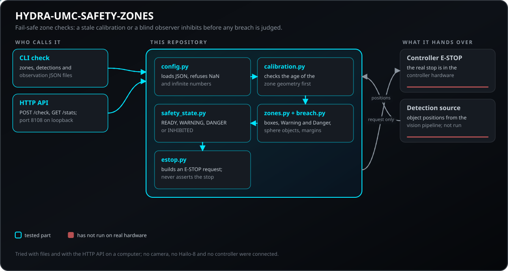
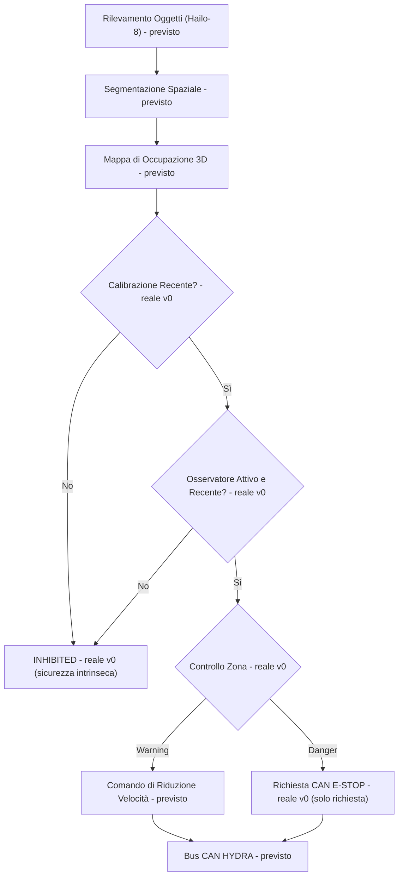
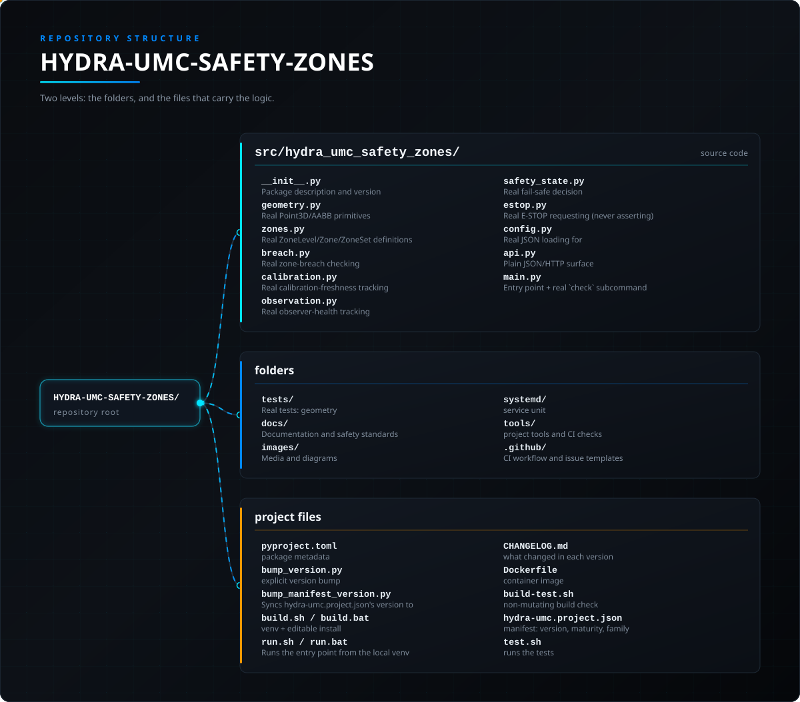

<!-- =============================================================================
HYDRA-UMC-SAFETY-ZONES - Safety zones and E-STOP requests for the Vision AI Node
Copyright (C) JuanenRac (Electro Hobby 3D) <electrohobby3d@gmail.com>
GPL-3.0-or-later - see LICENSE
============================================================================= -->

<p align="center">
  
</p>

# 🛑 HYDRA-UMC-SAFETY-ZONES

<p align="center"><a href="README.md">🇺🇸 English</a> | <a href="README_spa.md">🇪🇸 Español</a> | <a href="README_fra.md">🇫🇷 Français</a> | 🇮🇹 <b>Italiano</b> | <a href="README_deu.md">🇩🇪 Deutsch</a> | <a href="README_zho.md">🇨🇳 简体中文</a> | <a href="README_jpn.md">🇯🇵 日本語</a> | <a href="README_por.md">🇵🇹 Português</a></p>

### 🚨 Logica di violazione zona e richiesta E-STOP (v0: ancora nessun rilevatore né E-STOP fisico)

<p align="center">
  
  
  
  
  
  
</p>

---

> **Stato di sicurezza (safety e security):** questo ecosistema non è un sistema di sicurezza certificato. Non esiste ancora un percorso E-STOP hardware, né limiti o interblocchi imposti dal firmware, né un comando di movimento verificato; le immagini firmware sono controllate con CRC-32 e una firma Ed25519, e una compilazione di rilascio rifiuta le chiavi di sviluppo pubblicate (le teste utensile e le schede di espansione dietro il relè usano ancora i bootloader di URTC, che accettano un HMAC-SHA256 a chiave condivisa invece di una firma); TLS e TLS reciproco sono opzionali e disattivati per impostazione predefinita; nessuna scheda propria è stata ancora assemblata o provata. Leggi la [base di sicurezza](https://github.com/JuanenRac/HYDRA-UMC-DOCS/blob/main/docs/SECURITY_BASELINE.md) e il [modello delle minacce](https://github.com/JuanenRac/HYDRA-UMC-DOCS/blob/main/docs/THREAT_MODEL.md) prima di fidarti di qualsiasi affermazione qui per la sicurezza di una persona.

---

## 📋 In breve

| | |
|---|---|
| Versione | `0.1.8` |
| Maturità | Funzionale |
| Test | 802 (`python -m pytest -q tests`) |
| Tecnologia | Python / 3D vision / Hailo-8 |
| Destinazione | Il Raspberry Pi CM5 di una cella HYDRA-UMC |
| Su hardware reale | Non ancora: per questa versione non risulta alcuna esecuzione su hardware reale |

**Vai a:** [Panoramica](#-panoramica) · [Architettura](#-architettura) · [Sicurezza e protezione](#-sicurezza-e-protezione) · [Interfacce](#-interfacce) · [Configurazione](#-configurazione) · [Avvio rapido](#-avvio-rapido) · [Test](#-test) · [Risoluzione dei problemi](#-risoluzione-dei-problemi) · [Struttura del repository](#-struttura-del-repository) · [Progetti correlati](#-progetti-correlati)

## 🚦 Stato del progetto

Ogni riga è una parte di questo repository e il semaforo dice a che punto è oggi. È scritta in base a ciò che il repository può mostrare (test, compilazioni, esecuzioni), non a ciò che è previsto.

🟢 Fatto e verificato · 🟡 Funziona, con limiti noti · 🟠 Fatto a metà o non ancora verificato · 🔴 Non fatto o non funzionante

| Area | Stato | Cosa significa qui |
|---|---|---|
| Software | 🟡 | Funziona per il suo scopo principale; la verifica di onestà qui sopra elenca ciò che manca ancora |
| Test | 🟢 | 802 test automatici, eseguiti a ogni modifica |
| Hardware reale | 🔴 | Non ancora: per questa versione non risulta alcuna esecuzione su hardware reale |
| Documentazione | 🟢 | README in otto lingue, verificato rispetto al manifesto a ogni modifica |

## 🎯 Panoramica

**HYDRA-UMC-SAFETY-ZONES** è pensato per essere il sottosistema di sicurezza critico della famiglia Vision AI Node. Il suo compito previsto è proiettare volumi 3D virtuali attorno ai robot e monitorare l'area di lavoro per intrusioni umane o oggetti estranei, usando la segmentazione spaziale ad alta velocità della NPU Hailo-8 (prevista: questa pipeline non esiste ancora) per rilevare violazioni in zone "Warning" e "Danger" definite.

Questo è uno dei 4 figli di **[HYDRA-UMC-VISION-NODE](https://github.com/JuanenRac/HYDRA-UMC-VISION-NODE)**, il genitore di integrazione della famiglia, e il suo input di percezione è costruito su modelli compilati dal fratello **[HYDRA-UMC-DETECTION-HEF](https://github.com/JuanenRac/HYDRA-UMC-DETECTION-HEF)**.

### Punti Chiave

* 🚦 **Zone Multilivello (v0):** vere definizioni `Zone`/`ZoneLevel` (Warning/Danger) su volumi 3D allineati agli assi, e vero controllo delle violazioni (`check_breaches`) tra un set di zone e un set di posizioni di oggetti rilevati.
* 🛑 **Richiesta E-STOP (v0, non attivazione):** ogni oggetto la cui violazione peggiore è Danger produce un vero `EStopRequest`, consegnato a un `EStopRequester` - vedi il confine di design sotto per il perché nulla qui attiva mai da solo l'arresto fisico.
* 🔒 **Applicazione della freschezza di calibrazione (v0):** ogni set di zone porta una `calibration` opzionale (versione, fonte, data di calibrazione, età massima in giorni). `evaluate_safety()` la controlla **prima** di eseguire qualsiasi logica di violazione - un set di zone senza alcuna calibrazione, più vecchio del proprio `max_age_days` dichiarato, o datato nel futuro, si risolve sempre in `INHIBITED`, senza mai ricadere silenziosamente su `READY` solo perché nessun oggetto rilevato è vicino a una zona.
* 👁️ **Applicazione della salute dell'osservatore (v0):** `evaluate_safety()` accetta anche uno stato `observation` opzionale (attivo/inattivo, ultimo orario di osservazione, proprio errore) - vedi [`docs/CLI_REFERENCE.md`](docs/CLI_REFERENCE.md). Nessuna evidenza di osservazione, un osservatore disabilitato, un errore segnalato dall'osservatore, o un'osservazione obsoleta si risolvono tutti in `INHIBITED` prima che qualsiasi logica di violazione venga eseguita - esattamente come una calibrazione mancante: un rilevatore crashato o un avvio fresco non devono mai essere letti silenziosamente come "confermato libero" solo perché non sono stati segnalati oggetti.
* 🧮 **Salvaguardia delle coordinate finite (v0):** `config.py` rifiuta qualsiasi `x`/`y`/`z` `NaN`/`Infinity`/`-Infinity` in un file di zone o rilevamenti *prima* che `evaluate_safety()` venga eseguito, risolvendo direttamente in `INHIBITED` (uscita `3`) invece di valutare un confine con una coordinata che non può rappresentare un punto reale.
* 🧱 **Nessun NaN spegne una zona, né nella libreria né al bordo:** `Point3D` rifiuta coordinate non finite (un angolo NaN rendeva `contains()` sempre falso: una zona che non scatta mai), `AABB.expanded()` e `velocity_margin_m()` rifiutano un margine o una velocità NaN o infiniti (una velocità NaN costruiva una scatola di NaN attorno a ogni zona) e un `DetectedObject` non può avere una posizione NaN. *(implementato)*
* 🧍 **Gli oggetti hanno un'estensione:** `DetectedObject.radius_m` (JSON `radiusM`, predefinito 0) rende un oggetto una sfera: viola ogni zona che la sfera tocca, quindi una persona il cui centro è fuori da una zona ma il cui braccio vi entra è una violazione (`AABB.intersects_sphere`, inclusivo come `contains()`; raggio 0 è esattamente il vecchio comportamento puntuale). *(implementato)*
* 🌐 **API JSON/HTTP (v0.0.7):** il sottocomando `serve` espone la stessa identica logica di `check` (`evaluate_safety()`/`check_breaches()`/`request_estop_for()`) su un `http.server` della stdlib (`POST /check`, `GET /stats`) per chi non usa la CLI - solo loopback di default, come l'unità `systemd/hydra-umc-safety-zones.service`. Vedi [`docs/CLI_REFERENCE.md`](docs/CLI_REFERENCE.md) per ogni comando, flag e codice di uscita reale.
* 📏 **Inviluppi di sicurezza proporzionali alla velocità (v0.1.0, prima versione limitata):** `POST /check` accetta un `toolVelocityMps` opzionale (velocità reale della testa/dell'utensile, metri/secondo) - il volume statico di ogni zona cresce allora di un margine lineare in quella velocità (`AABB.expanded()`), limitato a un massimo fisso. Il volume statico configurato è sempre il limite inferiore incondizionato: una velocità omessa o nulla lascia ogni zona identica byte per byte, e il ridimensionamento può solo ingrandire una zona, mai ridurla.
* 📐 **Modello opzionale di distanza di separazione ISO 13855 / ISO 13857:** un file di zone può dichiarare `"separation": {"approach_speed_mps": K, "total_stop_time_s": T, "intrusion_distance_m": C}` (e, facoltativamente, `tool_deceleration_mps2`). Le zone crescono allora di `S = K·T + C` più la distanza che l'utensile percorre ancora mentre la macchina si ferma (`v·T`, e `v²/2a` se è data la decelerazione), con tetto di 10 m. Ogni valore viene dalla valutazione dei rischi della cella; nulla è presunto. Il margine lineare resta il minimo conservativo, quindi il modello può solo ingrandire una zona, e con un modello le zone crescono anche senza velocità inviata. *(implementato, spento se non dichiarato)*
* 🔐 **Il server può tenere le proprie regole (v0):** `serve --zones-file PATH` fissa zone e calibrazione sul server (una richiesta che invia zone proprie viene rifiutata e ogni verdetto porta il `configSha256` del file); `--max-observation-age-seconds` e `--max-calibration-age-days` limitano per quanto tempo una richiesta può dichiarare valide le proprie prove; `--token` / `SAFETY_ZONES_TOKEN` fa richiedere un token bearer a `POST /check`; un client che annuncia un corpo e non invia nulla viene scartato dopo 10 s. Senza `--zones-file`, chi raggiunge la porta decide le zone: tienila su loopback o dietro un token. NaN e Infinity sono rifiutati in ogni input JSON, un'ora senza fuso orario è rifiutata, una cella senza zone non è accettata, e tutto ciò che la CLI non riesce a leggere è `INHIBITED` (uscita `3`), mai uscita `1`. *(implementato)*
* 📐 **Occlusione Dinamica (previsto):** mascherare automaticamente la struttura del robot stesso dai trigger di sicurezza, così che il robot non "rilevi se stesso" come intrusione.
* 🔍 **Rilevamento Oggetti Estranei (previsto):** identificare utensili o detriti lasciati nell'area di lavoro.
* 🎥 **Vera mappatura di occupazione 3D da Hailo-8 (previsto):** il sottocomando `check` di v0 prende le posizioni degli oggetti rilevati da un file JSON proprio perché la vera pipeline di segmentazione spaziale Hailo-8 che le produrrebbe non esiste ancora in questo ambiente - vedi "Verifica di onestà" sotto.
* 🧩 **Perché esiste come progetto separato:** la logica di sicurezza ha una soglia di verifica diversa dal resto della percezione - isolarla nel proprio servizio permette di testarla, verificarla ed eventualmente certificarla (vedi il badge ISO 13849-1 sopra, aspirazionale in questa fase) indipendentemente da modifiche alla pipeline camera o alla compilazione modelli altrove nella famiglia.

**Un confine di design critico, già deciso e ora applicato nel codice:** questo progetto solo **rileva e richiede** un E-STOP - non attiva mai il segnale fisico di arresto da solo. L'unico requester reale di `estop.py`, `NullEStopRequester`, registra ciò che avrebbe inviato senza trasmettere nulla a nessuno - non esiste ancora un vero trasporto CAN in questo repository, di proposito. Tagliare realmente l'alimentazione del motore via CAN è responsabilità di [HYDRA-UMC](https://github.com/JuanenRac/HYDRA-UMC) (il firmware), su hardware costruito per quel ruolo. Mantenere il confine lì significa che un bug in questo servizio Python può fallire nel *richiedere* un arresto, ma non può mai *impedire* che il firmware lo applichi indipendentemente. Oggi il firmware non ha alcun frame di E-STOP da ricevere e `NullEStopRequester` non trasmette nulla: questa difesa in profondità è il progetto e non esiste ancora all'altro capo.

**Verifica di onestà - cosa funziona davvero oggi:** l'entry point reale (`src/hydra_umc_safety_zones/main.py`) continua a stampare identità/versione/ruolo con una chiamata senza argomenti, ma ora ha anche un vero sottocomando `check --zones PERCORSO --detections PERCORSO [--observation PERCORSO]`: carica un set di zone (zone + metadati di calibrazione opzionali), posizioni di oggetti rilevati e uno stato di osservazione opzionale da JSON, controlla prima la freschezza della calibrazione, poi la salute dell'osservatore (nessuno stato di osservazione, un osservatore disabilitato/in errore/obsoleto si risolvono tutti in `INHIBITED` esattamente come una calibrazione mancante), poi esegue un vero controllo delle violazioni, richiede E-STOP per ogni violazione Danger, ed esce con 0 (Ready) / 1 (Warning) / 2 (Danger, E-STOP richiesto) / 3 (Inhibited - calibrazione assente/scaduta, o osservatore assente/disabilitato/obsoleto/in errore) a seconda del risultato. Ciò che davvero non è ancora reale: la segmentazione spaziale Hailo-8 che produrrebbe quelle posizioni di oggetti rilevati su hardware reale, il mascheramento di auto-occlusione, il vero processo osservatore la cui vivacità `--observation` segnala, e qualsiasi vero trasporto CAN per la richiesta E-STOP. Vedi [`CHANGELOG.md`](CHANGELOG.md) per ciò che è stato consegnato esattamente finora, e "Stato Attuale e Prossimi Passi" più sotto per ciò che resta aperto.

## 🧩 Ruolo in HYDRA-UMC

**HYDRA-UMC-SAFETY-ZONES** è il sottosistema di sicurezza della famiglia Vision AI Node: confronta le posizioni degli oggetti rilevati con volumi di avviso e di pericolo attorno ai robot e risponde READY, WARNING, DANGER o INHIBITED. Richiede soltanto un arresto di emergenza; l'arresto fisico resta nell'hardware del controllore.

## 🏛️ Architettura

<p align="center">
  
</p>

<details>
<summary>Versione testuale del diagramma (Mermaid)</summary>



</details>

### FLUSSO DI LOGICA DI SICUREZZA PREVISTO

Il diagramma sotto è il flusso dati obiettivo verso cui viene costruito questo progetto. `CAL` (controllo calibrazione), `OBS` (controllo salute osservatore), `ZONE` (Controllo Zona) e la ripartizione Warning/Danger successiva sono reali oggi, guidati da `evaluate_safety()` (che avvolge `check_breaches()`/`request_estop_for()`), date posizioni di oggetti rilevati da un file JSON. Tutto ciò che precede `CAL`/`OBS`/`ZONE` (la vera pipeline Hailo-8, e il vero processo osservatore la cui vivacità `OBS` controlla) e segue `STOP` (il vero trasporto CAN) resta lavoro futuro.

### INFORMAZIONI TECNICHE AVANZATE

### Il confine rileva-vs-applica, e perché conta particolarmente qui

Di tutto ciò che c'è in questo README, questa è l'unica decisione di design che non è solo un dettaglio implementativo: questo servizio è pensato per *decidere* che serve un arresto e *richiederlo* via CAN, ma il taglio fisico reale dell'alimentazione del motore avviene su hardware dentro [HYDRA-UMC](https://github.com/JuanenRac/HYDRA-UMC) costruito e certificato per quel ruolo. È una scelta deliberata di difesa in profondità - un bug software qui (un crash, un blocco, un fotogramma errato) degrada a "non vengono inviate nuove richieste di arresto", non a "l'hardware di sicurezza esistente del robot smette di funzionare".

### Perché non ci sono `hardware/`, `firmware/`, `os/` né `models/` qui

CM5 + Hailo-8 è hardware già esistente senza una scheda propria da progettare, quindi - come il resto della famiglia Vision AI Node - non esiste cartella `hardware/`/`firmware/` qui. `os/` (l'immagine HydraOS condivisa) e `models/` (i `.hef` compilati realmente serviti alla NPU) vivono solo nel genitore di integrazione, [HYDRA-UMC-VISION-NODE](https://github.com/JuanenRac/HYDRA-UMC-VISION-NODE), perché è lui a possedere l'immagine dell'host CM5 e l'handle del dispositivo Hailo-8.

### Decisioni di design già prese

* **La versione viene letta dai metadati del pacchetto installato, non è hardcoded** - `main.py` chiama `importlib.metadata.version("hydra-umc-safety-zones")` invece di una seconda stringa `__version__`, così `bump_version.py` ha un solo posto da modificare.
* **L'incremento "contachilometri" tocca automaticamente solo `PATCH`/`MINOR`** - `bump_version.py` riporta `PATCH` a `MINOR` oltre il 9 e da `MINOR` a `MAJOR` oltre il 9, ma non incrementa mai `MAJOR` da solo; stessa convenzione di `HYDRA-UMC-EDITOR-URDF/bump_version.py` e `HYDRA-UMC-SUITE/bump_version.py`.
* **Zone AABB, non mesh né inviluppi convessi** - il volume più semplice che permette comunque a `check_breaches()` di essere esatto e veloce; un vero perimetro nella pratica assomiglia molto spesso a una scatola, e una forma più ricca può essere aggiunta in seguito dietro la stessa interfaccia `Zone`/`AABB.contains()` senza toccare `breach.py` né `estop.py`.
* **Il contenimento del confine di zona è inclusivo, non esclusivo** - `AABB.contains()` tratta un punto esattamente sul bordo come interno. Per un perimetro di sicurezza, questa è la direzione conservativa in cui sbagliare: può solo causare un report di violazione più anticipato, mai uno mancato.
* **`NullEStopRequester` è l'unico requester in questo repository** - non un placeholder in attesa di essere sostituito con leggerezza, ma l'incarnazione onesta del confine rileva-vs-applica stesso: non c'è un vero trasporto CAN qui, e non dovrebbe essercene uno aggiunto con noncuranza più avanti (vedi "Un confine di design critico" sopra e il docstring proprio del modulo `estop.py`).
* **Zone e rilevamenti sono JSON semplice, non YAML** - la lista di dipendenze di `pyproject.toml` resta `[]`; `json` è della libreria standard, `pyyaml` è vero lavoro futuro una volta che esisterà un vero strumento di creazione zone che valga la pena serializzare.
* **La calibrazione viene controllata prima di qualsiasi logica di violazione, mai dopo** - `evaluate_safety()` restituisce `INHIBITED` nel momento in cui la calibrazione è assente o scaduta, prima ancora di chiamare `check_breaches()`. Questo è deliberato: una calibrazione scaduta significa che la geometria di zona stessa non è affidabile, quindi il risultato dell'esecuzione dei controlli di violazione contro di essa sarebbe comunque privo di senso - controllare prima la calibrazione significa anche che una calibrazione scaduta vince sempre su ciò che altrimenti sembrerebbe una vera violazione Danger, non il contrario.
* **Una chiave `"calibration"` assente si carica con successo, significa solo `INHIBITED`** - `load_zone_set()` non solleva mai un errore solo perché un file di zone precede questa funzionalità o è stato scritto a mano senza metadati di calibrazione; fallisce in modo sicuro per design al momento della valutazione, non al caricamento.
* **`--observation`/`"observation"` è opzionale a livello di interfaccia, non a livello di sicurezza** - un chiamante che non lo passa mai ottiene ogni volta un `INHIBITED` onesto, mai un crash e mai un `READY` silenzioso; questo mantiene il livello di parsing retrocompatibile per i chiamanti non ancora aggiornati, chiudendo al contempo il vero divario in cui una lista `objects` vuota era indistinguibile da un vero osservatore attivo che conferma la cella libera.

## 🔒 Sicurezza e protezione

| Minaccia | Difesa | Dove |
|---|---|---|
| Una calibrazione scaduta o assente lascia una zona muta | `evaluate_safety()` controlla la calibrazione prima di ogni logica di violazione e risponde INHIBITED se manca o è troppo vecchia | `calibration.py`, `safety_state.py` |
| Un osservatore spento o muto fa sembrare sicura una scena vuota | Senza prova di un osservatore attivo e recente la risposta è INHIBITED, mai READY | `observation.py` |
| Un NaN o un numero infinito crea una zona che non scatta mai | `Point3D` e il caricatore JSON rifiutano i numeri non finiti; la riga di comando termina con codice 3 e INHIBITED | `geometry.py`, `config.py` |
| Un chiamante che allenta il perimetro inviando zone proprie | Con `--zones-file` il server tiene le zone e rifiuta una richiesta che porta le proprie; un token Bearer (`SAFETY_ZONES_TOKEN`) è confrontato in tempo costante, i corpi si fermano a 1 MiB e si servono 32 connessioni alla volta | `api.py`, `main.py` |

**Cosa non fa mai:** attivare l'arresto fisico o dichiarare READY per supposizione.

## 🔌 Interfacce

`serve --decision-log FILE` (o `SAFETY_ZONES_DECISION_LOG`; `-` per lo standard error) scrive una riga JSON per ogni verdetto di `POST /check` con l'ora, lo stato, il motivo, l'hash della configurazione e il numero di violazioni e richieste di arresto. È spento salvo indicazione, e un registro che non può essere scritto non cambia mai il verdetto.

`GET /state` (stesso token di `POST /check`) restituisce l'ultimo verdetto come SafetyState dell'SDK con l'ora in cui è stato emesso, oppure `404` prima del primo; un consumatore come il servizio di visual servoing lo legge invece di fidarsi di ciò che dice un chiamante. È tenuto solo in memoria.

**Forme di zona (facoltativo).** Un file di zone con `"geometry": {"shapes": true}` può usare, accanto alle scatole, zone di forma `obb` (scatola orientata), `cylinder` (verticale) e `capsule`. Sono disattivate per impostazione predefinita: un file che ne nomina una senza l'interruttore viene rifiutato, e i file con sole scatole si comportano esattamente come prima. Ogni forma sovrastima la zona e non la sottostima mai, e `"mode": "bounding"` sostituisce ogni forma con la scatola che la contiene. Nulla di questo è stato provato con un robot reale, e non sa dove sia il robot: una capsula su un elemento di un braccio è quindi una zona fissa. Vedi `docs/GEOMETRY.md`.

**Modalità con stato (facoltativa).** `serve --stateful` (o `SAFETY_ZONES_STATEFUL=1`, o `"stateful": {"enabled": true}` nel file di zone) aggiunge `POST /heartbeat`, con cui l'osservatore dimostra di essere vivo: ogni heartbeat vale alcuni secondi secondo l'orologio del servizio, qualunque ora scriva l'osservatore, e una richiesta non può più portare una propria osservazione. `GET /events` invia lo stato come Server-Sent Events a ogni cambiamento e pubblica da solo INHIBITED quando scade un verdetto o l'heartbeat; un consumatore deve considerare il silenzio come non sicuro. Vive solo in memoria, non pubblica nulla su MQTT e non è stata provata con un osservatore reale. Disattivata per impostazione predefinita, le due rotte non esistono. Vedi `docs/STATEFUL.md`.

**Corpo del robot (opzionale).** Con `"geometry": {"robot_body": true}` nel file delle zone, `POST /check` (e `check --body FILE`) accetta un `robotBody`: i due estremi di ogni segmento del robot, come li ha collocati la cinematica diretta, e un raggio che l'impianto dichiara per ogni segmento (non c'è un valore predefinito). Il servizio costruisce le capsule nel sistema di riferimento delle zone e le confronta con le zone, con gli stessi margini di velocità e di separazione di un oggetto rilevato, sovrastimando sempre: ogni segmento viene suddiviso in sfere che lo contengono e un banco di prova con seme fisso verifica che una zona attorno a qualsiasi punto della capsula sia una violazione. È disattivata per impostazione predefinita: una richiesta che porta un corpo viene allora rifiutata con `400` e INHIBITED (mai ignorata), un corpo malformato fa rifiutare l'intera richiesta e `required` rende INHIBITED una richiesta senza corpo. `body-from-fk` trasforma l'output di `hydra-umc-physics-replica fk --json` e un file che nomina i segmenti nel corpo; questo servizio non esegue mai quel programma. Nulla di tutto ciò è stato provato con un robot reale e non è una funzione di sicurezza certificata. Vedere `docs/ROBOT_BODY.md`.

## ⚙️ Configurazione

Il servizio HTTP si configura con opzioni; due possono arrivare anche dall'ambiente.

| Variabile | Predefinito | Cosa imposta |
|---|---|---|
| `--addr` | `127.0.0.1` | indirizzo su cui ascolta l'API |
| `--port` | `8108` | porta dell'API |
| `--zones-file` / `SAFETY_ZONES_FILE` | nessuno | zone e calibrazione che il server tiene fisse |
| `--token` / `SAFETY_ZONES_TOKEN` | nessuno | token Bearer richiesto da POST /check |
| `--max-observation-age-seconds` | nessuno | tetto per l'età che una richiesta può dichiarare per la sua osservazione |
| `--max-calibration-age-days` | nessuno | tetto per l'età massima della calibrazione in giorni |

## 🚀 Avvio rapido

Richiede Python 3.10 o successivo.

```bash
./build.sh  # Linux, macOS (build.bat on Windows)
./run.sh
./run.sh check --zones zones.json --detections detections.json --observation observation.json
./run.sh serve --zones-file zones.json --port 8108
```

## 🧪 Test

802 test automatici si eseguono con `python -m pytest -q tests`. Non richiedono hardware né nulla al di fuori di questa macchina.

La CI esegue `HYDRA_UMC_CI=1 python tools/ci_validate.py`, che controlla il manifesto, i documenti, gli otto README e le immagini.

## 🏗️ Compilazione e rilascio

### Prerequisiti

* **Python 3.10 o superiore** nel `PATH` (gli script provano `python3` poi ripiegano su `python`).
* Non serve ancora alcuna dipendenza runtime di sicurezza/visione - **zero dipendenze di terze parti a runtime** in questa fase (`dependencies = []` in `pyproject.toml`); `pytest` è un extra solo di sviluppo usato esclusivamente per la vera suite di test.
* Poche decine di MB di spazio su disco per un ambiente virtuale locale sotto `.venv/`.

### Passo dopo passo

```bash
# Linux / macOS
./build.sh
```

1. **Lettura della versione** - legge e stampa la versione del progetto; compilare non la cambia mai (solo `python tools/hydra_project_tool.py bump` la alza).
2. **Ambiente virtuale** - crea `.venv/` se manca; lo riutilizza altrimenti.
3. **Installazione editabile (con extra dev)** - `pip install -e ".[dev]"` così le modifiche sotto `src/` hanno effetto immediato, installa `pytest`, e registra l'entry point da console `hydra-umc-safety-zones`.
4. **Compile-check** - `python -m compileall -q src` compila in bytecode ogni file sotto `src/`.
5. **Vera suite di test** - `pytest tests/` esegue tutti i 802 test.

`set -euo pipefail` ferma lo script al primo passo che fallisce; la finestra resta aperta (`Press Enter to close...`) se è stata avviata con doppio clic invece che da un terminale già aperto.

```bash
./run.sh
```

Individua l'interprete dentro `.venv` ed esegue `python -m hydra_umc_safety_zones.main`, inoltrando ogni argomento.

L'invocazione senza argomenti stampa nome + versione + ruolo:

```text
HYDRA-UMC-SAFETY-ZONES v0.1.8
Real-time 3D intrusion detection and E-STOP orchestration for robotic safe-working areas.
```

Il vero sottocomando `check` necessita di un file di zone e uno di rilevamenti, entrambi JSON semplice, più un file di stato osservazione opzionale. `calibration` è opzionale nel file di zone, e `--observation` è opzionale sulla riga di comando - vedi sotto cosa succede senza:

```json
// zones.json
{
  "calibration": {"version": "cal-1", "source": "manual", "calibrated_at": "2024-01-15", "max_age_days": 30, "calibrated_by": "A. Operator"},
  "zones": [
    {"id": "warn1", "level": "warning", "min": {"x": 0, "y": 0, "z": 0}, "max": {"x": 5, "y": 5, "z": 5}},
    {"id": "danger1", "level": "danger", "min": {"x": 0, "y": 0, "z": 0}, "max": {"x": 1, "y": 1, "z": 1}}
  ]
}
```

```json
// detections.json
{"objects": [{"id": "op1", "position": {"x": 0.5, "y": 0.5, "z": 0.5}}]}
```

```json
// observation.json - vera evidenza che i rilevamenti sopra provengono
// davvero da un osservatore attivo e aggiornato di recente
{"active": true, "observedAt": "2024-01-15T12:00:00Z", "maxAgeSeconds": 5}
```

Le date in questi esempi sono solo esempi: `calibrated_at` deve essere abbastanza recente per `max_age_days`, e `observedAt` deve rientrare in `maxAgeSeconds` rispetto a ora (con fuso orario, ad esempio una `Z` finale); con le date mostrate, oggi il risultato è `INHIBITED`, non il `DANGER` qui sotto.

```bash
./run.sh check --zones zones.json --detections detections.json --observation observation.json
```

```text
SAFETY STATE: DANGER - object(s) ['op1'] breached a danger zone
BREACH: object 'op1' inside warning zone 'warn1'
BREACH: object 'op1' inside danger zone 'danger1'
E-STOP REQUESTED: object 'op1' breached danger zone 'danger1' (not asserted - see estop.py)
```

Esce con `2` (Danger, E-STOP richiesto), `1` (violazione solo Warning), `0` (nessuna violazione, calibrazione valida, osservatore attivo e recente), o `3` (**Inhibited** - calibrazione assente/scaduta, o osservatore assente/disabilitato/obsoleto/in errore, controllata prima di qualsiasi logica di violazione). Esempio reale del percorso di sicurezza intrinseca - le stesse `detections.json` sopra, ma `zones.json` senza alcuna chiave `"calibration"`:

```bash
./run.sh check --zones zones_no_calibration.json --detections detections.json --observation observation.json
```

```text
SAFETY STATE: INHIBITED - no calibration metadata present - zone geometry cannot be trusted
```

Esce con `3` - nota che non c'è alcun output `BREACH`/`E-STOP`, anche se `op1` si trova dentro entrambe le zone: un set di zone non affidabile non raggiunge mai il passaggio di controllo delle violazioni. Omettere del tutto `--observation` fallisce in modo altrettanto sicuro, anche con calibrazione fresca e nessun oggetto vicino a una zona:

```bash
./run.sh check --zones zones.json --detections detections_clear.json
```

```text
SAFETY STATE: INHIBITED - no observation status provided - cannot confirm the supplied detections reflect a real, active observer
```

```bat
:: Windows - stessi passi, sintassi batch
build.bat
run.bat
run.bat check --zones zones.json --detections detections.json --observation observation.json
```

La stessa logica di `check` è raggiungibile anche via HTTP, per chi non usa la CLI - `zones`/`detections`/`observation` viaggiano nel corpo JSON invece che come percorso di file:

```bash
./run.sh serve --addr 127.0.0.1 --port 8108
# in un altro terminale:
curl -s -X POST http://127.0.0.1:8108/check -d '{"zones": {...}, "detections": {...}, "observation": {...}}'
```

Vedi [`docs/CLI_REFERENCE.md`](docs/CLI_REFERENCE.md) per il riferimento completo di comandi, flag e codici di uscita, incluso ogni stato reale (`READY`/`WARNING`/`DANGER`/`INHIBITED`) catturato da un'esecuzione reale.

### Risoluzione dei problemi

* **`python`/`python3` non trovato** - installa Python 3.10+ e assicurati che sia nel `PATH`.
* **`compileall` fallisce** - è stato introdotto un vero errore di sintassi sotto `src/`; il build si ferma senza toccare l'installazione, di proposito.
* **"No `.venv` found" da `run.sh`/`run.bat`** - esegui `build.sh`/`build.bat` almeno una volta prima.
* **Installazione editabile obsoleta** - elimina `.venv/` e ricostruisci; raramente necessario.
* **`check` esce con codice diverso da zero** - è comportamento reale e corretto, non un fallimento: `1` significa che è stata trovata una violazione solo Warning, `2` significa che una violazione Danger ha richiesto un E-STOP, `3` significa che la calibrazione del set di zone è assente/scaduta o lo stato dell'osservatore è assente/disabilitato/obsoleto/in errore (sicurezza intrinseca, controllata prima che venga eseguita qualsiasi logica di violazione). Solo un traceback Python o un errore di JSON malformato è un vero bug.

## 🩺 Risoluzione dei problemi

| Vedi | Perché | Fai |
|---|---|---|
| `SAFETY STATE: INHIBITED` + exit code 3 | Manca la calibrazione o l'osservazione, o è troppo vecchia, oppure un numero nei file non è finito | Leggi il messaggio, rinnova la calibrazione o il file di osservazione e riesegui `check` |
| HTTP 401 | Il server ha un token e la richiesta non ne ha o ne ha uno sbagliato | Invia `Authorization: Bearer <token>` |

## 📂 Struttura del repository

<p align="center">
  
</p>

<details>
<summary>Versione testuale dell'albero</summary>

```text
HYDRA-UMC-SAFETY-ZONES/
├── src/hydra_umc_safety_zones/   codice sorgente
│   ├── __init__.py               Descrizione e versione del pacchetto
│   ├── geometry.py               Vere primitive Point3D/AABB
│   ├── zones.py                  Vere definizioni ZoneLevel/Zone/ZoneSet
│   ├── shapes.py                 Scatole orientate, cilindri e capsule
│   ├── robot_body.py             Il corpo del robot come capsule, sovrastimato
│   ├── fk_input.py               Corpo del robot dall'output di fk --json
│   ├── breach.py                 Vero controllo delle violazioni di zona
│   ├── calibration.py            Vero tracciamento della freschezza di calibrazione
│   ├── observation.py            Vero tracciamento della salute dell'osservatore - rispecchia calibration.py
│   ├── safety_state.py           Vera decisione di sicurezza intrinseca: READY/WARNING/DANGER/INHIBITED
│   ├── estop.py                  Vera richiesta E-STOP (mai attivazione)
│   ├── config.py                 Vero caricamento JSON per zone/rilevamenti/osservazione
│   ├── api.py                    Superficie JSON/HTTP semplice (http.server di stdlib) sulla vera logica `check`
│   ├── stateful.py               Heartbeat e stato inviato (opzionale)
│   └── main.py                   Entry point + vero sottocomando `check`
├── tests/                        Test veri: geometria, violazioni, calibrazione, osservazione, safety_state, estop, config, api, CLI
├── docs/                         Documentazione e standard di sicurezza
├── images/                       Media e diagrammi
├── systemd/                      unità di servizio
├── tools/                        strumenti del progetto e controlli della CI
├── .github/                      workflow di CI e modelli di segnalazione
├── pyproject.toml                Metadati pacchetto, dipendenze, versione contachilometri
├── bump_version.py               Incremento di versione stile contachilometri (eseguito solo dal comando `bump` esplicito)
├── bump_manifest_version.py      Sincronizza la versione di hydra-umc.project.json con quella nativa (--sync)
├── build.sh / build.bat          venv + installazione editabile (extra dev) + compile-check + test
├── run.sh / run.bat              Esegue l'entry point dal venv locale (inoltra gli argomenti)
├── CHANGELOG.md                  Storico versione per versione (schema contachilometri, senza date)
├── Dockerfile                    immagine del container
├── build-test.sh                 controllo di build senza modifiche
├── hydra-umc.project.json        manifesto: versione, maturità, famiglia
└── test.sh                       esegue i test
```

</details>

## 🗺️ Roadmap e limiti noti

**Limiti noti oggi**

**Cosa funziona oggi:** vere definizioni di zone Warning/Danger e vero controllo delle violazioni (`geometry.py`/`zones.py`/`breach.py`), una vera applicazione della freschezza di calibrazione che fallisce in modo sicuro verso `INHIBITED` prima di qualsiasi logica di violazione (`calibration.py`/`safety_state.py`), una vera pipeline di *richiesta* E-STOP che rispetta il confine rileva-vs-applica per costruzione (`estop.py`), un vero sottocomando CLI `check` su file JSON di zone/rilevamenti, e 802 test superati - vedi [`CHANGELOG.md`](CHANGELOG.md) per l'output completo reale di build/run.

**Cosa resta aperto, senza ordine particolare e senza calendario impegnato:**

* La vera mappatura di occupazione 3D dalla segmentazione spaziale di Hailo-8, per produrre davvero le posizioni di oggetti rilevati che `check` oggi si aspetta come input JSON.
* Il mascheramento dinamico di auto-occlusione della struttura del robot.
* Un vero trasporto CAN che implementi `EStopRequester` verso [HYDRA-UMC](https://github.com/JuanenRac/HYDRA-UMC) - `estop.py` già definisce l'interfaccia che un'implementazione reale dovrebbe soddisfare.
* Qualsiasi vero lavoro di certificazione di sicurezza (il badge ISO 13849-1 sopra esprime un'aspirazione, non una certificazione completata).

## 🌍 Lingue

Questo README e i documenti del repository esistono in otto lingue: inglese, spagnolo, tedesco, francese, italiano, giapponese, cinese e portoghese (Portogallo). Sono scritti insieme e la CI verifica che gli otto file abbiano le stesse sezioni e gli stessi link. Questo repository non ha uno schermo né un catalogo di messaggi propri, quindi non ci sono stringhe di interfaccia da tradurre.

## 🔗 Progetti correlati

Questo progetto fa parte dell'ecosistema robotico HYDRA-UMC dello stesso autore (JuanenRac / Electro Hobby 3D). Vale la pena conoscerlo, poiché una richiesta potrebbe in realtà riguardare uno di questi invece di questo repository.

**Progetto Padre**
- **[HYDRA-UMC-VISION-NODE](https://github.com/JuanenRac/HYDRA-UMC-VISION-NODE)** — hub di integrazione per la pipeline di visione Hailo-8, con un vero controllo di prontezza hardware per fase; il genitore di cui questo repository è una fase o un consumatore specifico, all'interno della propria pipeline di percezione.

**Progetti Fratelli** — le altre fasi/consumatori della pipeline di percezione Hailo-8 propria di HYDRA-UMC-VISION-NODE
- **[HYDRA-UMC-VISION-STREAMER](https://github.com/JuanenRac/HYDRA-UMC-VISION-STREAMER)** — generatore reale di pipeline GStreamer + config MediaMTX, con una vera barriera di integrazione HailoRT.
- **[HYDRA-UMC-DETECTION-HEF](https://github.com/JuanenRac/HYDRA-UMC-DETECTION-HEF)** — registro reale di modelli compilati con verifica di caricamento sicuro per architettura Hailo/checksum.
- **[HYDRA-UMC-VISUAL-SERVOING-API](https://github.com/JuanenRac/HYDRA-UMC-VISUAL-SERVOING-API)** — legge di correzione Position-Based Visual Servoing con autorizzazione condizionata allo stato di zona; ancora nessuna stima di posa da telecamera.

**Direttamente Correlati**
- **[HYDRA-UMC](https://github.com/JuanenRac/HYDRA-UMC)** — il progetto della scheda madre del braccio robotico: host CM5 + coprocessore STM32H745 dual-core, pensato per coordinare fino a 8 bracci utensile via CAN-OTA/SPI-OTA (firmware in fase iniziale; nessuna scheda assemblata per ora); questo progetto può richiedere un E-STOP, ma il firmware non ha ancora un percorso di E-STOP.

**Fa Anche Parte dell'Ecosistema**

*Hardware e Piattaforma di Base*
- **[HYDRA-UMC-OS](https://github.com/JuanenRac/HYDRA-UMC-OS)** — livello prodotto riproducibile su Raspberry Pi OS per il CM5: agente in sola lettura, config/profili validati, provisioning WiFi al primo contatto.
- **[HYDRA-UMC-SDK](https://github.com/JuanenRac/HYDRA-UMC-SDK)** — il contratto JSON-Schema condiviso e la barriera software di controllo dei job contro cui ogni bridge valida i propri comandi (non è una funzione di sicurezza certificata).
- **[HYDRA-UMC-CONNECTOR-HUB](https://github.com/JuanenRac/HYDRA-UMC-CONNECTOR-HUB)** — registro dichiarativo e validatore di manifesti adattatore per connettori di macchine esterne; estende la propria idea di contratto dell'SDK alle macchine esterne senza sostituire i progetti di gateway industriale.

*Backend Centrale e Client*
- **[HYDRA-UMC-SERVER](https://github.com/JuanenRac/HYDRA-UMC-SERVER)** — il vero backend headless (REST/WebSocket) con cui parla davvero ogni client di controllo.
- **[HYDRA-UMC-STUDIO](https://github.com/JuanenRac/HYDRA-UMC-STUDIO)** — dashboard di controllo web con visualizzazione 3D multi-robot in tempo reale.
- **[HYDRA-UMC-SUITE](https://github.com/JuanenRac/HYDRA-UMC-SUITE)** — centro di comando sciame desktop (PySide6) per più server contemporaneamente, pacchettizzato come eseguibile standalone.
- **[HYDRA-UMC-ANDROID-CONTROL](https://github.com/JuanenRac/HYDRA-UMC-ANDROID-CONTROL)** — app di controllo nativa per Android con login biometrico e un companion Wear OS abbinato.
- **[HYDRA-UMC-IOS-CONTROL](https://github.com/JuanenRac/HYDRA-UMC-IOS-CONTROL)** — app di controllo per iOS/iPadOS (Flutter) con sincronizzazione WebSocket in tempo reale.
- **[HYDRA-UMC-DSI](https://github.com/JuanenRac/HYDRA-UMC-DSI)** — interfaccia touch nativa per il touchscreen DSI da 7" a bordo, incorporata direttamente nel CM5.
- **[HYDRA-UMC-EDITOR-URDF](https://github.com/JuanenRac/HYDRA-UMC-EDITOR-URDF)** — creatore/editor grafico desktop di URDF che invia i modelli finiti al catalogo di STUDIO.
- **[HYDRA-UMC-EDITOR-STL](https://github.com/JuanenRac/HYDRA-UMC-EDITOR-STL)** — editor desktop di modelli STL, che trasforma/sostituisce/rimuove/aggiunge veri pezzi nello stesso catalogo di modelli modificato anche da HYDRA-UMC-EDITOR-URDF.
- **[HYDRA-UMC-BRIDGE-AMR](https://github.com/JuanenRac/HYDRA-UMC-BRIDGE-AMR)** — barriera di coordinamento per flotte AGV/AMR tramite un publisher MQTT VDA 5050 (testato solo contro una flotta emulata).
- **[HYDRA-UMC-BRIDGE-CNC](https://github.com/JuanenRac/HYDRA-UMC-BRIDGE-CNC)** — coordinatore ad alto livello per celle CNC con accesso a stato/byte di controllo GRBL (testato solo contro un emulatore).
- **[HYDRA-UMC-BRIDGE-DROIDS](https://github.com/JuanenRac/HYDRA-UMC-BRIDGE-DROIDS)** — barriera di coordinamento per droidi con zampe/umanoidi, con un mittente di comandi per Boston Dynamics Spot (testato solo contro un emulatore).
- **[HYDRA-UMC-BRIDGE-LASER](https://github.com/JuanenRac/HYDRA-UMC-BRIDGE-LASER)** — coordinatore per celle laser che legge 3 segnali GPIO di chiave/involucro/interblocco (testato solo contro un chip simulato; non può armare né far partire un laser).
- **[HYDRA-UMC-BRIDGE-OPENPNP](https://github.com/JuanenRac/HYDRA-UMC-BRIDGE-OPENPNP)** — coordinatore ad alto livello sicuro per il flusso schede del pick-and-place OpenPnP.
- **[HYDRA-UMC-BRIDGE-PRINTER3D](https://github.com/JuanenRac/HYDRA-UMC-BRIDGE-PRINTER3D)** — barriera di coordinamento sicura per stampanti 3D Moonraker/Klipper, con comandi di lavoro reali e controllati.
- **[HYDRA-UMC-BRIDGE-ROS2](https://github.com/JuanenRac/HYDRA-UMC-BRIDGE-ROS2)** — coordinatore con un trasporto ROS 2 rclpy importato in modo lazy (non ancora eseguito contro un'installazione ROS 2).
- **[HYDRA-UMC-BRIDGE-UAV](https://github.com/JuanenRac/HYDRA-UMC-BRIDGE-UAV)** — barriera di coordinamento per UAV dotati di fotocamera, con un mittente di comandi MAVLink (testato solo contro un emulatore).

*Piattaforma Strumenti URTC*
- **[URTC](https://github.com/JuanenRac/URTC)** — firmware per la scheda fisica dell'Universal Robot Tool Controller, oltre 25 profili utensile su bus CAN.
- **[URTC-FLASHER](https://github.com/JuanenRac/URTC-FLASHER)** — strumento desktop con GUI per il flashing delle schede URTC, CAN-OTA più SWD/JTAG a chip intero.
- **[URTC-TESTER](https://github.com/JuanenRac/URTC-TESTER)** — strumento desktop di diagnostica CAN-bus dal vivo per schede URTC, un pannello per profilo utensile.
- **[URTC-WEB-STUDIO](https://github.com/JuanenRac/URTC-WEB-STUDIO)** — alternativa basata su browser a URTC-TESTER tramite la Web Serial API, senza installazione locale.
- **[URTC-GATEWAY](https://github.com/JuanenRac/URTC-GATEWAY)** — gateway davanti al bus CAN di URTC: elenco di identificatori consentiti, limite di frequenza e chiave di sessione; software provato su computer, non ancora su un bus reale.

*Nodo IA Cognitivo (Hailo-10)*
- **[HYDRA-UMC-COGNITIVE-NODE](https://github.com/JuanenRac/HYDRA-UMC-COGNITIVE-NODE)** — hub di integrazione per la pipeline cognitiva Hailo-10 (orchestrazione LLM/VLA/voce).
- **[HYDRA-UMC-VLA-ENGINE](https://github.com/JuanenRac/HYDRA-UMC-VLA-ENGINE)** — vera codifica/decodifica di token d'azione e generazione di traiettoria per un modello Vision-Language-Action.
- **[HYDRA-UMC-VOICE-UI](https://github.com/JuanenRac/HYDRA-UMC-VOICE-UI)** — vero front-end vocale (VAD + parser di intenti) con un relay verso Watch limitato e soggetto a conferma.
- **[HYDRA-UMC-SEMANTIC-PLANNER](https://github.com/JuanenRac/HYDRA-UMC-SEMANTIC-PLANNER)** — vera scomposizione dei task basata su regole e recupero semantico degli errori sui codici errore MCU.
- **[HYDRA-UMC-DOCS-QA](https://github.com/JuanenRac/HYDRA-UMC-DOCS-QA)** — vera ricerca documentale TF-IDF (solo libreria standard) sui documenti Markdown di questo ecosistema.
- **[HYDRA-UMC-LOCAL-TECHNICIAN](https://github.com/JuanenRac/HYDRA-UMC-LOCAL-TECHNICIAN)** — tecnico di manutenzione IA locale e con cancelli di policy per l'ecosistema stesso - osserva, diagnostica e propone correzioni; i due livelli di rischio più alti non sono deliberatamente ancora implementati.

*Orchestrazione e Sciame*
- **[HYDRA-UMC-ORCHESTRATOR](https://github.com/JuanenRac/HYDRA-UMC-ORCHESTRATOR)** — hub di integrazione con un vero contratto di health-report gRPC/Protobuf e una macchina a stati di missione.
- **[HYDRA-UMC-JOB-DISPATCHER](https://github.com/JuanenRac/HYDRA-UMC-JOB-DISPATCHER)** — vera coda di lavori basata su priorità con deduplicazione, su una vera API HTTP.
- **[HYDRA-UMC-NODE-HEALING](https://github.com/JuanenRac/HYDRA-UMC-NODE-HEALING)** — vero watchdog di salute della flotta basato su gRPC, con retry/backoff e rilevamento di discrepanza d'identità.
- **[HYDRA-UMC-PATH-PLANNER-3D](https://github.com/JuanenRac/HYDRA-UMC-PATH-PLANNER-3D)** — vero pianificatore di percorsi 3D basato su RRT, con vera validazione delle collisioni ostacolo/spazio di lavoro.
- **[HYDRA-UMC-SWARM-SYNC](https://github.com/JuanenRac/HYDRA-UMC-SWARM-SYNC)** — vera sincronizzazione di stato CRDT LWW-Element-Map, con property test per la convergenza multi-cella.

*Gemello Digitale e Simulazione*
- **[HYDRA-UMC-TWIN](https://github.com/JuanenRac/HYDRA-UMC-TWIN)** — hub di integrazione per il motore di gemello digitale, con un vero contratto di sincronizzazione per compatibilità di versione.
- **[HYDRA-UMC-HIL-BRIDGE](https://github.com/JuanenRac/HYDRA-UMC-HIL-BRIDGE)** — router hardware-in-the-loop con un interblocco software di collisione tra simulazione e hardware reale (testato senza hardware reale).
- **[HYDRA-UMC-PHYSICS-REPLICA](https://github.com/JuanenRac/HYDRA-UMC-PHYSICS-REPLICA)** — vera cinematica diretta e validazione dei limiti articolari su un vero sottoinsieme URDF.
- **[HYDRA-UMC-SYNTHETIC-DATA-GEN](https://github.com/JuanenRac/HYDRA-UMC-SYNTHETIC-DATA-GEN)** — vero generatore procedurale di scene 2D con esportazione di annotazioni YOLO/COCO.

*Dati e Analisi*
- **[HYDRA-UMC-DATALAKE](https://github.com/JuanenRac/HYDRA-UMC-DATALAKE)** — vero archivio di serie temporali basato su sqlite3, con una vera API HTTP di ingestione/query.
- **[HYDRA-UMC-ANOMALY-DETECTOR](https://github.com/JuanenRac/HYDRA-UMC-ANOMALY-DETECTOR)** — vero rilevatore di anomalie FFT + baseline statistica, con monitoraggio della deriva.
- **[HYDRA-UMC-PRODUCTION-REPORTS](https://github.com/JuanenRac/HYDRA-UMC-PRODUCTION-REPORTS)** — vero calcolo OEE/disponibilità sullo storico di DATALAKE, con esportazione CSV riproducibile.
- **[HYDRA-UMC-TELEMETRY-COLLECTOR](https://github.com/JuanenRac/HYDRA-UMC-TELEMETRY-COLLECTOR)** — vera pipeline di ingestione CAN/WebSocket verso DATALAKE, con deduplicazione per sequenza.

*Gateway Industriale*
- **[HYDRA-UMC-GATEWAY-INDUSTRIAL](https://github.com/JuanenRac/HYDRA-UMC-GATEWAY-INDUSTRIAL)** — hub di integrazione che inoltra ai protocolli industriali, con un vero livello di allowlist dei comandi/backpressure.
- **[HYDRA-UMC-OPCUA-SERVER](https://github.com/JuanenRac/HYDRA-UMC-OPCUA-SERVER)** — vero spazio di indirizzi OPC-UA, verificato con una vera sessione client del protocollo binario.
- **[HYDRA-UMC-MQTT-BROKER](https://github.com/JuanenRac/HYDRA-UMC-MQTT-BROKER)** — vero broker MQTT con autenticazione opzionale per client e ACL sui topic.
- **[HYDRA-UMC-MTCONNECT-ADAPTER](https://github.com/JuanenRac/HYDRA-UMC-MTCONNECT-ADAPTER)** — veri endpoint XML `/probe` e `/current` di MTConnect, con output in modalità degradata.

*Strumenti Complementari e Operazioni dell'Ecosistema*
- **[HYDRA-UMC-DASHBOARD-AI](https://github.com/JuanenRac/HYDRA-UMC-DASHBOARD-AI)** — pannelli Smart Summaries e Anomaly Highlighting su DATALAKE/ANOMALY-DETECTOR, con un fallback statistico onesto.
- **[HYDRA-UMC-TOOL-CLI](https://github.com/JuanenRac/HYDRA-UMC-TOOL-CLI)** — CLI di flotta con un vero e stabile contratto di exit-code, un client live reale della stessa API di HYDRA-UMC-SERVER.
- **[HYDRA-UMC-WATCH](https://github.com/JuanenRac/HYDRA-UMC-WATCH)** — app companion WearOS con schemi di avviso aptico e un relay vocale verso il telefono abbinato (non ancora eseguita su un orologio fisico).
- **[URTC-SMART-RACK](https://github.com/JuanenRac/URTC-SMART-RACK)** — firmware per un rack di montaggio schede con decodifica reale dell'ID utensile e logica di preriscaldamento Smart Idle.
- **[URTC-VISION-TOOL](https://github.com/JuanenRac/URTC-VISION-TOOL)** — firmware più un vero companion di visione Python per una testa utensile di ispezione termica/RGB.
- **[HYDRA-UMC-UPDATER](https://github.com/JuanenRac/HYDRA-UMC-UPDATER)** — strumento amministrativo desktop che scopre, clona e aggiorna ogni repository di questo ecosistema.
- **[HYDRA-UMC-OS-REBUILDER](https://github.com/JuanenRac/HYDRA-UMC-OS-REBUILDER)** — strumento desktop Windows/Linux che costruisce un'immagine della CM5 pronta da scrivere, precaricata con le versioni più aggiornate dell'ecosistema, con configurazione di primo avvio Wi-Fi/utente/SSH in stile Raspberry Pi Imager.
- **[HYDRA-UMC-OPS-AGENT](https://github.com/JuanenRac/HYDRA-UMC-OPS-AGENT)** — coordinatore di incidenti di manutenzione: un ruolo edge a basso privilegio raccoglie uno snapshot di inventario/salute sanificato, un ruolo control-plane lo rende in sola lettura e chiede a un provider di IA di suggerire una diagnosi - non applica mai una patch né distribuisce nulla.
- **[HYDRA-UMC-DEV-SERVER](https://github.com/JuanenRac/HYDRA-UMC-DEV-SERVER)** — host di sviluppo riproducibile (Raspberry Pi 5 / CM5) che conserva il codice sorgente dell'ecosistema ed esegue attività delimitate di build/test tramite una coda durevole; un ruolo di sviluppo dedicato, esplicitamente distinto da un CM5 operativo.

## 📚 Documentazione

Dove leggere di più:

* [Base di sicurezza dell'ecosistema](https://github.com/JuanenRac/HYDRA-UMC-DOCS/blob/main/docs/SECURITY_BASELINE.md)
* [Modello delle minacce dell'ecosistema](https://github.com/JuanenRac/HYDRA-UMC-DOCS/blob/main/docs/THREAT_MODEL.md)
* [Registro delle modifiche di questo repository](CHANGELOG.md)
* [Licenza di questo repository](LICENSE.md)

## 🤝 Contribuire e comunità

* Prima di una pull request esegui `HYDRA_UMC_CI=1 py -3 tools/ci_validate.py` (oppure `HYDRA_UMC_CI=1 python3 tools/ci_validate.py`): deve stampare `CI_VALIDATION=PASS`. Non eseguire `build.sh` né `build.bat` per questa verifica; compilare non è verificare.
* I otto README sono scritti da un'unica fonte in HYDRA-UMC-DOCS; non modificarli a mano. Cambia la fonte e riscrivili con `tools/make_readmes.py`.
* Non affermare in un README ciò che non è stato eseguito: scrivi «simulato» o «non provato su hardware» quando è la verità.
* Vedi [CONTRIBUTING.md](CONTRIBUTING.md), il [codice di condotta](CODE_OF_CONDUCT.md), [SECURITY.md](SECURITY.md) e [SUPPORT.md](SUPPORT.md).

## 👤 AUTORE

**JuanenRac (Electro Hobby 3D)** · electrohobby3d@gmail.com

## 📜 LICENZA

GPL-3.0-or-later - [LICENSE](LICENSE).
