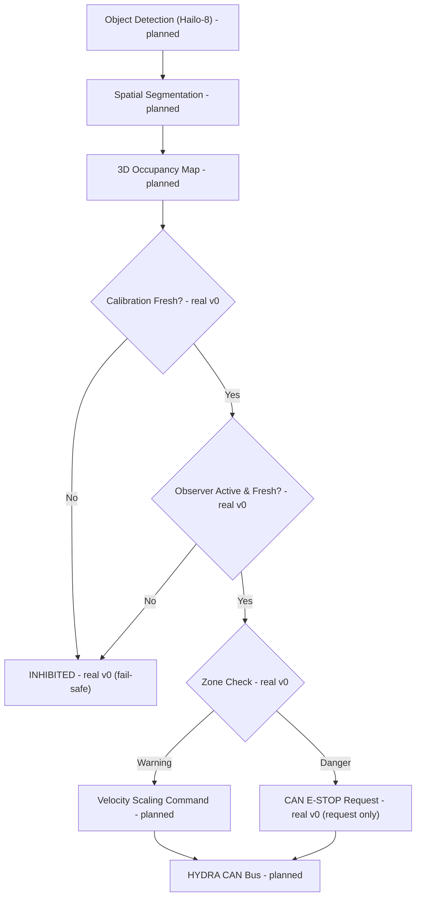

<p align="center">
  
</p>

# 🛡️ HYDRA-UMC-SAFETY-ZONES

<p align="center"><a href="README.md">🇺🇸 English</a> | <a href="README_spa.md">🇪🇸 Español</a> | <a href="README_fra.md">🇫🇷 Français</a> | <a href="README_ita.md">🇮🇹 Italiano</a> | <a href="README_deu.md">🇩🇪 Deutsch</a> | <a href="README_zho.md">🇨🇳 简体中文</a> | <a href="README_jpn.md">🇯🇵 日本語</a> | 🇵🇹 <b>Português</b></p>

### 🚨 Lógica de violação de zonas e pedido de E-STOP (v0: ainda sem detetor nem E-STOP físico)

<p align="center">
  
  
  
</p>

---

> **Estado de segurança (safety e security):** este ecossistema não é um sistema de segurança certificado. Ainda não existe um caminho de E-STOP por hardware, nem limites ou interlocks impostos pelo firmware, nem um comando de movimento verificado; as imagens de firmware são verificadas com CRC32 e um HMAC-SHA256 de chave partilhada, não com uma assinatura assimétrica; TLS e TLS mútuo são opcionais e estão desativados por defeito; nenhuma placa própria foi ainda montada ou testada. Leia a [base de segurança](https://github.com/JuanenRac/HYDRA-UMC-DOCS/blob/main/docs/SECURITY_BASELINE.md) e o [modelo de ameaças](https://github.com/JuanenRac/HYDRA-UMC-DOCS/blob/main/docs/THREAT_MODEL.md) antes de confiar em qualquer afirmação aqui para a segurança de uma pessoa.

## 📋 Num relance

| | |
|---|---|
| Versão | `0.1.4` |
| Maturidade | Funcional |
| Tecnologia | Python / 3D vision / Hailo-8 |
| Destino | O Raspberry Pi CM5 de uma célula HYDRA-UMC |
| Em hardware real | Ainda não: não há registo de execução em hardware real para esta versão |

## 1. 🛠️ VISÃO TÉCNICA GERAL

O **HYDRA-UMC-SAFETY-ZONES** destina-se a ser o subsistema de segurança crítico da família Vision AI Node. A sua função prevista é projetar volumes 3D virtuais à volta dos robôs e vigiar o espaço de trabalho à procura de intrusões humanas ou objetos estranhos, usando a segmentação espacial de alta velocidade do NPU Hailo-8 (prevista: esse pipeline ainda não existe) para detetar violações nas zonas definidas de "Aviso" e "Perigo".

É um dos 4 filhos do **[HYDRA-UMC-VISION-NODE](https://github.com/JuanenRac/HYDRA-UMC-VISION-NODE)**, o pai de integração da família, e a sua entrada de perceção assenta em modelos compilados pelo seu irmão **[HYDRA-UMC-DETECTION-HEF](https://github.com/JuanenRac/HYDRA-UMC-DETECTION-HEF)**.

### Pontos-chave

* 🚦 **Zonas multinível (v0):** definições reais de `Zone`/`ZoneLevel` (Aviso/Perigo) sobre volumes 3D alinhados com os eixos, e verificação real de violações (`check_breaches`) entre um conjunto de zonas e um conjunto de posições de objetos detetados.
* 🛑 **Pedido de E-STOP (v0, pede mas não aciona):** cada objeto cuja pior violação é de Perigo produz um `EStopRequest` real, entregue a um `EStopRequester` - veja abaixo a fronteira de desenho que explica porque nada aqui aciona alguma vez a própria paragem física.
* 🔒 **Imposição da frescura da calibração (v0):** cada conjunto de zonas traz uma `calibration` opcional (versão, origem, data de calibração, idade máxima em dias). O `evaluate_safety()` verifica-a **antes** de executar qualquer lógica de violação - um conjunto de zonas sem calibração, com uma mais antiga do que o seu próprio `max_age_days` declarado, ou com data no futuro, resolve-se sempre em `INHIBITED`, nunca cai num `READY` silencioso só porque nenhum objeto detetado está junto a uma zona.
* 👁️ **Imposição da saúde do observador (v0):** o `evaluate_safety()` aceita também um estado `observation` opcional (ativo/inativo, última hora observada, erro próprio) - veja [`docs/CLI_REFERENCE.md`](docs/CLI_REFERENCE.md). Nenhuma evidência de observador, um observador desativado, um erro reportado pelo observador ou uma observação antiga resolvem-se em `INHIBITED` antes de qualquer lógica de violação, exatamente como uma calibração em falta - um detetor que falhou ou um arranque recente nunca devem ler-se em silêncio como "confirmado livre" só porque não se reportou nenhum objeto.
* 🧮 **Falha segura de coordenadas finitas (v0):** o `config.py` rejeita qualquer `x`/`y`/`z` `NaN`/`Infinity`/`-Infinity` num ficheiro de zonas ou de deteções *antes* de o `evaluate_safety()` correr, resolvendo diretamente em `INHIBITED` (saída `3`) em vez de avaliar uma fronteira contra uma coordenada que não consegue representar um ponto real.
* 🧱 **Nenhum NaN desliga uma zona, na biblioteca como na fronteira:** `Point3D` recusa coordenadas não finitas (um canto de zona NaN tornava `contains()` sempre falso: uma zona que nunca dispara), `AABB.expanded()` e `velocity_margin_m()` recusam uma margem ou velocidade NaN ou infinitas (uma velocidade NaN construía uma caixa de NaN à volta de cada zona), e um `DetectedObject` não pode ter uma posição NaN. *(implementado)*
* 🧍 **Os objetos têm extensão:** `DetectedObject.radius_m` (JSON `radiusM`, por defeito 0) faz de um objeto uma esfera: viola todas as zonas que a esfera toca, pelo que uma pessoa cujo centro está fora de uma zona mas cujo braço entra nela é uma violação (`AABB.intersects_sphere`, inclusivo como `contains()`; o raio 0 é exatamente o comportamento pontual anterior). *(implementado)*
* 🌐 **API JSON/HTTP (v0.0.7):** o subcomando `serve` expõe a mesma lógica exata de `evaluate_safety()`/`check_breaches()`/`request_estop_for()` do `check` sobre um `http.server` simples da biblioteca padrão (`POST /check`, `GET /stats`) para chamadores que não são a própria CLI - só em loopback por defeito, em linha com a unidade `systemd/hydra-umc-safety-zones.service`. Veja [`docs/CLI_REFERENCE.md`](docs/CLI_REFERENCE.md) para cada comando, opção e código de saída reais.
* 📏 **Envolventes de segurança proporcionais à velocidade (v0.1.0, primeira versão limitada):** `POST /check` aceita um `toolVelocityMps` opcional (velocidade real da cabeça/ferramenta, metros/segundo) - o volume estático de cada zona cresce então por uma margem linear nessa velocidade (`AABB.expanded()`), com um máximo fixo. O volume estático configurado é sempre o piso incondicional: uma velocidade omitida ou nula deixa cada zona igual byte a byte, e a escala só pode fazer crescer uma zona, nunca encolhê-la.
* 📐 **Modelo opcional de distância de separação ISO 13855 / ISO 13857:** um ficheiro de zonas pode declarar `"separation": {"approach_speed_mps": K, "total_stop_time_s": T, "intrusion_distance_m": C}` (e, opcionalmente, `tool_deceleration_mps2`). As zonas crescem então `S = K·T + C` mais a distância que a ferramenta ainda percorre enquanto a máquina pára (`v·T`, e `v²/2a` se a desaceleração for dada), com limite de 10 m. Cada valor vem da avaliação de riscos da própria célula; nada é presumido. A margem linear fica como piso conservador, pelo que o modelo só pode aumentar uma zona, e com um modelo as zonas crescem mesmo sem velocidade enviada. *(implementado, desligado se não for declarado)*
* 🔐 **O servidor pode ter as suas próprias regras (v0):** `serve --zones-file PATH` fixa as zonas e a calibração no servidor (um pedido que envie as suas próprias zonas é recusado e cada veredicto leva o `configSha256` do ficheiro); `--max-observation-age-seconds` e `--max-calibration-age-days` limitam durante quanto tempo um pedido pode afirmar que a sua evidência continua válida; `--token` / `SAFETY_ZONES_TOKEN` faz o `POST /check` exigir um token bearer; um cliente que anuncia um corpo e não envia nada é descartado ao fim de 10 s. Sem `--zones-file`, quem alcançar a porta decide as zonas: mantenha-a em loopback ou atrás de um token. NaN e Infinity são recusados em toda a entrada JSON, uma hora sem fuso horário é recusada, uma célula sem zonas não é aceite, e tudo o que a CLI não consiga ler é `INHIBITED` (saída `3`), nunca saída `1`. *(implementado)*
* 📐 **Oclusão dinâmica (planeada):** mascarar automaticamente a própria estrutura do robô dos disparos de segurança, para que o robô não se "detete a si próprio" como intrusão.
* 🔍 **Deteção de objetos estranhos (planeada):** identificar ferramentas ou resíduos deixados no espaço de trabalho.
* 🎥 **Mapeamento 3D de ocupação real a partir do Hailo-8 (planeado):** o subcomando `check` da v0 recebe as posições dos objetos detetados de um ficheiro JSON precisamente porque o pipeline real de segmentação espacial do Hailo-8 que as produziria ainda não existe neste ambiente - veja a "Verificação de honestidade" abaixo.
* 🧩 **Porque existe como projeto próprio:** a lógica de segurança tem um nível de verificação diferente do resto da perceção - isolá-la no seu próprio serviço significa que pode ser testada, auditada e, eventualmente, certificada (veja o distintivo ISO 13849-1 acima, aspiracional nesta fase) independentemente de alterações ao pipeline de câmaras ou à compilação de modelos noutros pontos da família.

**Uma fronteira de desenho crítica, já decidida e agora imposta em código:** este projeto só **deteta e pede** um E-STOP - nunca aciona o sinal de paragem física. A única implementação real de pedidos de `estop.py`, `NullEStopRequester`, regista o que teria enviado sem transmitir nada a lado nenhum - não há ainda um transporte CAN real neste repositório, de propósito. Cortar de facto a potência dos motores por CAN é responsabilidade do [HYDRA-UMC](https://github.com/JuanenRac/HYDRA-UMC) (do firmware), em hardware construído para esse papel. Manter a fronteira aí significa que um erro neste serviço Python pode falhar em *pedir* uma paragem, mas nunca pode *impedir* o firmware de impor uma de forma independente. Hoje o firmware não tem nenhuma trama de E-STOP para receber e o `NullEStopRequester` não transmite nada: esta defesa em profundidade é o desenho e ainda não existe na outra ponta.

**Verificação de honestidade - o que realmente funciona hoje:** o ponto de entrada real (`src/hydra_umc_safety_zones/main.py`) continua a imprimir identidade/versão/função numa chamada simples, mas tem agora também um subcomando real `check --zones PATH --detections PATH [--observation PATH]`: carrega de JSON um conjunto de zonas (zonas + metadados opcionais de calibração), posições de objetos detetados e um estado de observação opcional, verifica primeiro a frescura da calibração, depois a saúde do observador (sem estado de observação, um observador desativado/com erro/antigo falham de forma segura tal como uma calibração em falta), depois executa a verificação real de violações, pede E-STOPs para cada violação de Perigo, e termina com 0 (Pronto) / 1 (Aviso) / 2 (Perigo, E-STOP pedido) / 3 (Inibido - calibração em falta/caducada, ou observador em falta/desativado/antigo/com erro) consoante o resultado. O que genuinamente ainda não é real: a segmentação espacial do Hailo-8 que produziria essas posições de objetos detetados em hardware real, a máscara de autoclusão, o processo observador real cuja vida o `--observation` reporta, e qualquer transporte CAN real para o pedido de E-STOP. Veja o [`CHANGELOG.md`](CHANGELOG.md) para saber exatamente o que já foi entregue, e "Estado atual e próximos passos" abaixo para o que continua em aberto.

---

## 2. 🔄 FLUXO LÓGICO DE SEGURANÇA PRETENDIDO

O diagrama abaixo é o fluxo de dados de destino para que este projeto está a ser construído. `CAL` (verificação da calibração), `OBS` (verificação da saúde do observador), `ZONE` (verificação de zonas) e a divisão Aviso/Perigo que se segue são reais hoje, impulsionados por `evaluate_safety()` (que envolve `check_breaches()`/`request_estop_for()`), dadas posições de objetos detetados a partir de um ficheiro JSON. Tudo o que está a montante de `CAL`/`OBS`/`ZONE` (o pipeline real do Hailo-8 e o processo observador real cuja vida o `OBS` verifica) e a jusante de `STOP` (o transporte CAN real) continua a ser trabalho futuro.



---

## 3. 🧠 INFORMAÇÃO TÉCNICA AVANÇADA

### A fronteira detetar-vs-impor, e porque importa aqui em particular

De tudo neste README, esta é a única decisão de desenho que não é apenas um pormenor de implementação: este serviço destina-se a *decidir* que é preciso uma paragem e a *pedi-la* por CAN, mas o corte físico real da potência dos motores acontece em hardware dentro do [HYDRA-UMC](https://github.com/JuanenRac/HYDRA-UMC) construído e certificado para esse papel. É uma escolha deliberada de defesa em profundidade - um erro de software aqui (uma falha, um bloqueio, uma imagem má) degrada-se para "não se enviam novos pedidos de paragem", não para "o hardware de segurança já existente do robô deixa de funcionar".

### Porque não há aqui `hardware/`, `firmware/`, `os/` nem `models/`

O CM5 + Hailo-8 é hardware de prateleira sem placa própria a desenhar, pelo que - como no resto da família Vision AI Node - aqui não existe pasta `hardware/`/`firmware/`. O `os/` (a imagem HydraOS partilhada) e o `models/` (os ficheiros `.hef` compilados que realmente se servem ao NPU) vivem só no pai de integração, o [HYDRA-UMC-VISION-NODE](https://github.com/JuanenRac/HYDRA-UMC-VISION-NODE), já que é ele o dono da imagem do anfitrião CM5 e do manípulo do dispositivo Hailo-8.

### Decisões de desenho já tomadas

* **Versão lida dos metadados do pacote instalado, não escrita no código** - o `main.py` chama `importlib.metadata.version("hydra-umc-safety-zones")` em vez de uma segunda cadeia `__version__`, pelo que o `bump_version.py` só tem um sítio onde editar.
* **O odómetro só toca automaticamente em `PATCH`/`MINOR`** - o `bump_version.py` transporta `PATCH` para `MINOR` depois do 9 e `MINOR` para `MAJOR` depois do 9, mas nunca sobe o próprio `MAJOR`; a mesma convenção do `bump_version.py` do `HYDRA-UMC-EDITOR-URDF` e do `HYDRA-UMC-SUITE`.
* **Zonas AABB, não malhas nem envolventes convexas** - o volume mais simples que ainda permite ao `check_breaches()` ser exato e rápido; um perímetro real é muito frequentemente próximo de uma caixa na prática, e pode acrescentar-se mais tarde uma forma mais rica atrás da mesma interface `Zone`/`AABB.contains()` sem tocar em `breach.py` nem `estop.py`.
* **A contenção na fronteira da zona é inclusiva, não exclusiva** - o `AABB.contains()` trata um ponto exatamente no bordo como dentro. Num perímetro de segurança, é a direção conservadora de errar: só pode causar um relatório de violação mais cedo, nunca uma violação falhada.
* **O `NullEStopRequester` é o único pedidor neste repositório** - não um marcador à espera de ser trocado de ânimo leve, mas a materialização honesta da própria fronteira detetar-vs-impor: aqui não há transporte CAN real, e não deve acrescentar-se um sem cuidado mais tarde (veja "Uma fronteira de desenho crítica" acima e a docstring do módulo `estop.py`).
* **Zonas e deteções são JSON simples, não YAML** - a lista de dependências do `pyproject.toml` continua a ser `[]`; `json` é da biblioteca padrão, e `pyyaml` é trabalho futuro real quando existir uma ferramenta de autoria de zonas que valha a pena serializar.
* **A calibração verifica-se antes de qualquer lógica de violação, nunca depois** - o `evaluate_safety()` devolve `INHIBITED` no momento em que a calibração falta ou caducou, antes de o `check_breaches()` ser sequer chamado. É deliberado: uma calibração antiga significa que a própria geometria das zonas não é de confiança, pelo que o resultado de executar verificações de violação contra ela seria insignificante em qualquer dos casos - verificar a calibração primeiro significa também que uma calibração caducada ganha sempre ao que, de outro modo, pareceria uma violação de Perigo real, e não o contrário.
* **Uma chave `"calibration"` em falta carrega com sucesso, apenas significa `INHIBITED`** - o `load_zone_set()` nunca levanta erro só porque um ficheiro de zonas é anterior a esta funcionalidade ou foi escrito à mão sem metadados de calibração; falha de forma segura por desenho na avaliação em vez de falhar ao carregar.
* **`--observation`/`"observation"` é opcional ao nível da interface, não ao nível da segurança** - um chamador que nunca o passa recebe sempre um `INHIBITED` honesto, nunca uma falha e nunca um `READY` silencioso; isto mantém a camada de análise compatível com chamadores ainda por atualizar e fecha, ao mesmo tempo, a lacuna real em que uma lista `objects` vazia era indistinguível de um observador real e ativo a confirmar a célula livre.

---

## 📂 ESTRUTURA DE DIRETÓRIOS

```text
HYDRA-UMC-SAFETY-ZONES/
├── src/hydra_umc_safety_zones/
│   ├── geometry.py       # Primitivas reais Point3D/AABB
│   ├── zones.py          # Definições reais ZoneLevel/Zone/ZoneSet
│   ├── breach.py         # Verificação real de violações de zonas
│   ├── calibration.py    # Acompanhamento real da frescura da calibração
│   ├── observation.py    # Acompanhamento real da saúde do observador - espelha calibration.py
│   ├── safety_state.py   # Decisão real de falha segura: READY/WARNING/DANGER/INHIBITED
│   ├── estop.py          # Pedido real de E-STOP (nunca o aciona)
│   ├── config.py         # Carregamento JSON real de zonas/deteções/observação
│   ├── api.py             # Superfície JSON/HTTP simples (stdlib http.server) sobre a lógica real de `check`
│   └── main.py            # Ponto de entrada + subcomando real `check`
├── tests/                # Testes reais: geometria, violações, calibração, observação, safety_state, estop, config, api, CLI, finitude/extensão
├── docs/                # Documentação e normas de segurança
├── build/               # Saída de compilação (o .venv local também vive aqui)
├── images/              # Multimédia e diagramas
├── systemd/
│   └── hydra-umc-safety-zones.service # Unidade systemd local do CM5 para a API de verificação de violações de zonas
├── pyproject.toml       # Metadados do pacote, dependências, versão em odómetro
├── bump_version.py      # Subida de versão ao estilo conta-quilómetros (executada só pelo comando `bump` explícito)
├── bump_manifest_version.py # Sincroniza a versão de hydra-umc.project.json com a nativa (--sync)
├── build.sh / build.bat # venv + instalação editável (extras de desenvolvimento) + verificação de compilação + testes
├── build-test.sh / .bat # Verificação de compilação sem versão (nunca toca na versão nem no CHANGELOG)
├── tools/
│   ├── build_test.py    # Motor partilhado a que ambos os lançadores build-test delegam
│   └── ci_validate.py   # Validação de manifesto/CHANGELOG/docs usada pelo CI
├── run.sh / run.bat     # Executa o ponto de entrada a partir do venv local (reencaminha argumentos)
└── CHANGELOG.md         # Histórico versão a versão (esquema de odómetro, sem datas)
```

Sem pasta `hardware/`, `firmware/`, `os/` nem `models/` - veja "Informação técnica avançada" acima para saber porquê. O `os/` e o `models/` vivem só no pai de integração, o [HYDRA-UMC-VISION-NODE](https://github.com/JuanenRac/HYDRA-UMC-VISION-NODE).

---

## 🏗️ GUIA DE COMPILAÇÃO E EXECUÇÃO

### Pré-requisitos

* **Python 3.10 ou superior** no seu `PATH` (os scripts tentam `python3` e depois `python`).
* Ainda não se exige nenhuma dependência de execução de segurança/visão - **zero dependências de execução de terceiros** nesta fase (`dependencies = []` no `pyproject.toml`); o `pytest` é um extra só de desenvolvimento usado apenas para a suite de testes real.
* Algumas dezenas de MB de disco para um ambiente virtual local em `.venv/`.

### Passo a passo

```bash
# Linux / macOS
./build.sh
```

1. **Leitura da versão** - lê e mostra a versão do projeto; compilar nunca a altera (só `python tools/hydra_project_tool.py bump` a sobe).
2. **Ambiente virtual** - cria `.venv/` se faltar; reutiliza-o caso contrário.
3. **Instalação editável (com extras de desenvolvimento)** - `pip install -e ".[dev]"` para que as edições em `src/` tenham efeito de imediato, instala o `pytest` e regista o ponto de entrada de consola `hydra-umc-safety-zones`.
4. **Verificação de compilação** - `python -m compileall -q src` compila para bytecode cada ficheiro de `src/`, apanhando erros de sintaxe em todo o ecossistema.
5. **Suite de testes real** - `pytest tests/` executa os 228 testes.

O `set -euo pipefail` pára o script no primeiro passo que falhe; a janela fica aberta (`Press Enter to close...`) se foi aberta com duplo clique em vez de executada a partir de um terminal já aberto.

```bash
./run.sh
```

Localiza o interpretador dentro de `.venv` (tratando as disposições `.venv` de POSIX e de Windows) e executa `python -m hydra_umc_safety_zones.main`, reencaminhando quaisquer argumentos.

A invocação simples imprime nome + versão + função:

```text
HYDRA-UMC-SAFETY-ZONES v0.1.4
Real-time 3D intrusion detection and E-STOP orchestration for robotic safe-working areas.
```

O subcomando real `check` precisa de um ficheiro de zonas e de um ficheiro de deteções, ambos JSON simples, mais um ficheiro opcional de estado de observação. A `calibration` é opcional no ficheiro de zonas, e `--observation` é opcional na linha de comandos - veja abaixo o que acontece sem qualquer deles:

```json
// zones.json
{
  "calibration": {"version": "cal-1", "source": "manual", "calibrated_at": "2024-01-15", "max_age_days": 30, "calibrated_by": "A. Operator"},
  "zones": [
    {"id": "warn1", "level": "warning", "min": {"x": 0, "y": 0, "z": 0}, "max": {"x": 5, "y": 5, "z": 5}},
    {"id": "danger1", "level": "danger", "min": {"x": 0, "y": 0, "z": 0}, "max": {"x": 1, "y": 1, "z": 1}}
  ]
}
```

```json
// detections.json
{"objects": [{"id": "op1", "position": {"x": 0.5, "y": 0.5, "z": 0.5}}]}
```

```json
// observation.json - evidência real de que as deteções acima vieram de facto
// de um observador ativo e atualizado há pouco
{"active": true, "observedAt": "2024-01-15T12:00:00Z", "maxAgeSeconds": 5}
```

As datas destes exemplos são apenas exemplos: `calibrated_at` tem de ser suficientemente recente para `max_age_days`, e `observedAt` tem de estar dentro de `maxAgeSeconds` de agora (com fuso horário, por exemplo um `Z` final); com as datas mostradas, o resultado hoje é `INHIBITED`, e não o `DANGER` abaixo.

```bash
./run.sh check --zones zones.json --detections detections.json --observation observation.json
```

```text
SAFETY STATE: DANGER - object(s) ['op1'] breached a danger zone
BREACH: object 'op1' inside warning zone 'warn1'
BREACH: object 'op1' inside danger zone 'danger1'
E-STOP REQUESTED: object 'op1' breached danger zone 'danger1' (not asserted - see estop.py)
```

Termina com `2` (Perigo, E-STOP pedido), `1` (violação só de Aviso), `0` (sem violação, calibração válida, observador ativo e atualizado) ou `3` (**Inibido** - calibração em falta/caducada, ou observador ausente/desativado/antigo/com erro, verificado antes de qualquer lógica de violação). Exemplo real do caminho de falha segura - as mesmas `detections.json` acima, mas com um `zones.json` sem a chave `"calibration"`:

```bash
./run.sh check --zones zones_no_calibration.json --detections detections.json --observation observation.json
```

```text
SAFETY STATE: INHIBITED - no calibration metadata present - zone geometry cannot be trusted
```

Saída `3` - repare que não há qualquer saída `BREACH`/`E-STOP`, embora `op1` esteja dentro das duas zonas: um conjunto de zonas sem confiança nunca chega ao passo de verificação de violações. Omitir `--observation` falha de forma segura da mesma maneira, mesmo com uma calibração fresca e nenhum objeto junto a uma zona:

```bash
./run.sh check --zones zones.json --detections detections_clear.json
```

```text
SAFETY STATE: INHIBITED - no observation status provided - cannot confirm the supplied detections reflect a real, active observer
```

```bat
:: Windows - passos idênticos, sintaxe batch
build.bat
run.bat
run.bat check --zones zones.json --detections detections.json --observation observation.json
```

A mesma lógica de `check` também está acessível por HTTP, para chamadores que não são a própria CLI - `zones`/`detections`/`observation` viajam no corpo JSON em vez de um caminho de ficheiro:

```bash
./run.sh serve --addr 127.0.0.1 --port 8108
# noutro terminal:
curl -s -X POST http://127.0.0.1:8108/check -d '{"zones": {...}, "detections": {...}, "observation": {...}}'
```

Veja [`docs/CLI_REFERENCE.md`](docs/CLI_REFERENCE.md) para a referência completa de comandos/opções/códigos de saída, incluindo cada estado real (`READY`/`WARNING`/`DANGER`/`INHIBITED`) capturado de uma execução verdadeira.

### Resolução de problemas

* **`python`/`python3` não encontrado** - instale o Python 3.10+ e garanta que está no `PATH`.
* **O `compileall` falha** - introduziu-se um erro de sintaxe real em `src/`; a compilação pára sem tocar na instalação, de propósito.
* **"No `.venv` found" de `run.sh`/`run.bat`** - execute primeiro `build.sh`/`build.bat` pelo menos uma vez.
* **Instalação editável antiga** - apague o `.venv/` e recompile; raramente é preciso.
* **`check` termina com código diferente de zero** - é comportamento real e correto, não uma falha: `1` significa que se encontrou uma violação só de Aviso, `2` significa que uma violação de Perigo pediu um E-STOP, `3` significa que a calibração do conjunto de zonas falta/caducou ou que o estado do observador falta/está desativado/antigo/com erro (falha segura, verificada antes de qualquer lógica de violação). Só um traceback de Python ou um erro de JSON malformado é um erro a sério.

---

## 🚀 Estado atual e próximos passos

**O que funciona hoje:** definições reais de zonas de Aviso/Perigo e verificação de violações (`geometry.py`/`zones.py`/`breach.py`), imposição real da frescura da calibração que falha de forma segura para `INHIBITED` antes de qualquer lógica de violação (`calibration.py`/`safety_state.py`), um pipeline real de *pedido* de E-STOP que respeita a fronteira detetar-vs-impor por construção (`estop.py`), um subcomando de CLI real `check` sobre ficheiros JSON de zonas/deteções, e 228 testes a passar - veja o [`CHANGELOG.md`](CHANGELOG.md) para a saída real completa de compilação/execução.

**O que continua em aberto, sem ordem particular e sem prazo assumido:**

* Mapeamento 3D de ocupação real a partir da segmentação espacial do Hailo-8, para produzir de facto as posições de objetos detetados que o `check` espera hoje como entrada JSON.
* Máscara dinâmica de autoclusão da própria estrutura do robô.
* Um transporte CAN real que implemente `EStopRequester` em direção ao [HYDRA-UMC](https://github.com/JuanenRac/HYDRA-UMC) - o `estop.py` já define a interface que uma implementação real teria de cumprir.
* Qualquer trabalho real de certificação de segurança (o distintivo ISO 13849-1 acima declara uma aspiração, não uma certificação concluída).

---

## 🔗 Projetos relacionados

Este projeto faz parte do ecossistema de robótica HYDRA-UMC do mesmo autor (JuanenRac / Electro Hobby 3D). Vale a pena conhecê-los, porque um pedido pode ser, na verdade, sobre um destes e não sobre este repositório.

**Projeto-mãe**
- **[HYDRA-UMC-VISION-NODE](https://github.com/JuanenRac/HYDRA-UMC-VISION-NODE)** — hub de integração para o pipeline de visão Hailo-8, com uma verificação real de prontidão de hardware por etapa; o pai de que este repositório é uma etapa ou consumidor específico, dentro do seu próprio pipeline de perceção.

**Projetos irmãos** — as outras etapas/consumidores do próprio pipeline de perceção Hailo-8 do HYDRA-UMC-VISION-NODE
- **[HYDRA-UMC-VISION-STREAMER](https://github.com/JuanenRac/HYDRA-UMC-VISION-STREAMER)** — pipeline GStreamer real e gerador de configuração MediaMTX com uma fronteira de integração HailoRT real.
- **[HYDRA-UMC-DETECTION-HEF](https://github.com/JuanenRac/HYDRA-UMC-DETECTION-HEF)** — registo real de modelos compilados com verificação segura de carga por arquitetura Hailo e soma de verificação.
- **[HYDRA-UMC-VISUAL-SERVOING-API](https://github.com/JuanenRac/HYDRA-UMC-VISUAL-SERVOING-API)** — lei de correção de servovisão baseada em posição com autorização condicionada ao estado da zona; ainda sem estimativa de pose por câmara.

**Diretamente relacionados**
- **[HYDRA-UMC](https://github.com/JuanenRac/HYDRA-UMC)** — o desenho da placa-mãe do braço robótico: anfitrião CM5 + STM32H745 de dois núcleos, pensado para orquestrar até 8 braços de ferramenta por CAN-OTA/SPI-OTA (firmware numa fase inicial; ainda sem placa montada); este projeto pode pedir um E-STOP, mas o firmware ainda não tem caminho de E-STOP.

**Também fazem parte do ecossistema**

*Hardware e plataforma centrais*
- **[HYDRA-UMC-OS](https://github.com/JuanenRac/HYDRA-UMC-OS)** — camada de produto reproduzível do Raspberry Pi OS para o CM5: agente só de leitura, configuração/perfis validados, aprovisionamento Wi-Fi de primeiro contacto.
- **[HYDRA-UMC-SDK](https://github.com/JuanenRac/HYDRA-UMC-SDK)** — o contrato JSON-Schema partilhado e a fronteira de software de controlo de trabalhos contra a qual cada bridge valida os seus comandos (não é uma função de segurança certificada).
- **[HYDRA-UMC-CONNECTOR-HUB](https://github.com/JuanenRac/HYDRA-UMC-CONNECTOR-HUB)** — registo declarativo de manifestos de adaptador e validador para conectores de máquinas externas; estende a ideia de contrato do SDK a máquinas externas sem substituir os projetos de gateway industrial.

*Backend central e clientes*
- **[HYDRA-UMC-SERVER](https://github.com/JuanenRac/HYDRA-UMC-SERVER)** — o back-end headless real (REST/WebSocket) com que todos os clientes de controlo realmente comunicam.
- **[HYDRA-UMC-STUDIO](https://github.com/JuanenRac/HYDRA-UMC-STUDIO)** — painel web de controlo com visualização 3D em tempo real de vários robôs.
- **[HYDRA-UMC-SUITE](https://github.com/JuanenRac/HYDRA-UMC-SUITE)** — centro de comando de enxame para desktop (PySide6) para vários servidores ao mesmo tempo, empacotado como executável independente.
- **[HYDRA-UMC-ANDROID-CONTROL](https://github.com/JuanenRac/HYDRA-UMC-ANDROID-CONTROL)** — aplicação Android nativa de controlo, com início de sessão biométrico e um companheiro Wear OS emparelhado.
- **[HYDRA-UMC-IOS-CONTROL](https://github.com/JuanenRac/HYDRA-UMC-IOS-CONTROL)** — aplicação de controlo para iOS/iPadOS (Flutter) com sincronização WebSocket em tempo real.
- **[HYDRA-UMC-DSI](https://github.com/JuanenRac/HYDRA-UMC-DSI)** — interface tátil nativa para o ecrã tátil DSI de 7" integrado, executada no próprio CM5.
- **[HYDRA-UMC-EDITOR-URDF](https://github.com/JuanenRac/HYDRA-UMC-EDITOR-URDF)** — criador/editor gráfico de URDF para desktop que envia os modelos concluídos para o catálogo do STUDIO.
- **[HYDRA-UMC-EDITOR-STL](https://github.com/JuanenRac/HYDRA-UMC-EDITOR-STL)** — editor de modelos STL para desktop que transforma/substitui/remove/adiciona peças reais no mesmo catálogo de modelos que o HYDRA-UMC-EDITOR-URDF também edita.
- **[HYDRA-UMC-BRIDGE-AMR](https://github.com/JuanenRac/HYDRA-UMC-BRIDGE-AMR)** — fronteira de coordenação para frotas AGV/AMR através de um publicador MQTT VDA 5050 (testado apenas contra uma frota emulada).
- **[HYDRA-UMC-BRIDGE-CNC](https://github.com/JuanenRac/HYDRA-UMC-BRIDGE-CNC)** — coordenador de células CNC de alto nível com acesso ao estado GRBL e aos bytes de controlo (testado apenas contra um emulador).
- **[HYDRA-UMC-BRIDGE-DROIDS](https://github.com/JuanenRac/HYDRA-UMC-BRIDGE-DROIDS)** — fronteira de coordenação para droides com patas/humanoides, com um emissor de comandos para o Boston Dynamics Spot (testado apenas contra um emulador).
- **[HYDRA-UMC-BRIDGE-LASER](https://github.com/JuanenRac/HYDRA-UMC-BRIDGE-LASER)** — coordenador de células laser que lê 3 sinais GPIO (chave, caixa e interlock) (testado apenas contra um chip simulado; não pode armar nem disparar um laser).
- **[HYDRA-UMC-BRIDGE-OPENPNP](https://github.com/JuanenRac/HYDRA-UMC-BRIDGE-OPENPNP)** — coordenador seguro de fluxo de placa de alto nível para pick-and-place com OpenPnP.
- **[HYDRA-UMC-BRIDGE-PRINTER3D](https://github.com/JuanenRac/HYDRA-UMC-BRIDGE-PRINTER3D)** — fronteira de coordenação segura para impressoras 3D Moonraker/Klipper, com comandos de trabalho reais protegidos por portas.
- **[HYDRA-UMC-BRIDGE-ROS2](https://github.com/JuanenRac/HYDRA-UMC-BRIDGE-ROS2)** — coordenador com um transporte ROS 2 baseado em rclpy importado sob demanda (ainda não executado contra uma instalação ROS 2).
- **[HYDRA-UMC-BRIDGE-UAV](https://github.com/JuanenRac/HYDRA-UMC-BRIDGE-UAV)** — fronteira de coordenação para UAV com câmara, com um emissor de comandos MAVLink (testado apenas contra um emulador).

*Plataforma de ferramentas URTC*
- **[URTC](https://github.com/JuanenRac/URTC)** — firmware da placa física Universal Robot Tool Controller, mais de 25 perfis de ferramenta por barramento CAN.
- **[URTC-FLASHER](https://github.com/JuanenRac/URTC-FLASHER)** — ferramenta gráfica de gravação para desktop das placas URTC, por CAN-OTA e também SWD/JTAG de chip completo.
- **[URTC-TESTER](https://github.com/JuanenRac/URTC-TESTER)** — ferramenta de diagnóstico CAN em tempo real para desktop das placas URTC, com um painel por perfil de ferramenta.
- **[URTC-WEB-STUDIO](https://github.com/JuanenRac/URTC-WEB-STUDIO)** — alternativa no navegador ao URTC-TESTER através da Web Serial API, sem instalação local.
- **[URTC-GATEWAY](https://github.com/JuanenRac/URTC-GATEWAY)** — gateway à frente do barramento CAN do URTC: lista de identificadores permitidos, limite de taxa e chave de sessão; software testado num computador, ainda não num barramento real.

*Nó de IA cognitiva (Hailo-10)*
- **[HYDRA-UMC-COGNITIVE-NODE](https://github.com/JuanenRac/HYDRA-UMC-COGNITIVE-NODE)** — centro de integração do pipeline cognitivo do Hailo-10 (orquestração de LLM/VLA/voz).
- **[HYDRA-UMC-VLA-ENGINE](https://github.com/JuanenRac/HYDRA-UMC-VLA-ENGINE)** — codificação/descodificação real de tokens de ação e geração de trajetórias para um modelo Visão-Linguagem-Ação.
- **[HYDRA-UMC-VOICE-UI](https://github.com/JuanenRac/HYDRA-UMC-VOICE-UI)** — front-end de voz real (VAD + analisador de intenções) com um relé para o relógio limitado e protegido por confirmação.
- **[HYDRA-UMC-SEMANTIC-PLANNER](https://github.com/JuanenRac/HYDRA-UMC-SEMANTIC-PLANNER)** — decomposição real de tarefas baseada em regras e recuperação semântica de erros sobre os códigos de erro do MCU.
- **[HYDRA-UMC-DOCS-QA](https://github.com/JuanenRac/HYDRA-UMC-DOCS-QA)** — pesquisa real de documentos TF-IDF só com a biblioteca padrão sobre a documentação Markdown deste ecossistema.
- **[HYDRA-UMC-LOCAL-TECHNICIAN](https://github.com/JuanenRac/HYDRA-UMC-LOCAL-TECHNICIAN)** — técnico de manutenção de IA local, protegido por políticas, para o próprio ecossistema: observa, diagnostica e propõe correções; os dois níveis de maior risco não estão implementados de propósito.

*Orquestração e enxame*
- **[HYDRA-UMC-ORCHESTRATOR](https://github.com/JuanenRac/HYDRA-UMC-ORCHESTRATOR)** — centro de integração com um contrato real de relatório de saúde gRPC/Protobuf e uma máquina de estados de missões.
- **[HYDRA-UMC-JOB-DISPATCHER](https://github.com/JuanenRac/HYDRA-UMC-JOB-DISPATCHER)** — fila real de trabalhos por prioridade com deduplicação, sobre uma API HTTP real.
- **[HYDRA-UMC-NODE-HEALING](https://github.com/JuanenRac/HYDRA-UMC-NODE-HEALING)** — vigilante real de saúde da frota por gRPC com repetição/recuo e deteção de identidade incoerente.
- **[HYDRA-UMC-PATH-PLANNER-3D](https://github.com/JuanenRac/HYDRA-UMC-PATH-PLANNER-3D)** — planeador real de trajetórias 3D baseado em RRT com validação real de colisões com obstáculos e espaço de trabalho.
- **[HYDRA-UMC-SWARM-SYNC](https://github.com/JuanenRac/HYDRA-UMC-SWARM-SYNC)** — sincronização real de estado CRDT LWW-Element-Map, testada por propriedades para a convergência de várias células.

*Gémeo digital e simulação*
- **[HYDRA-UMC-TWIN](https://github.com/JuanenRac/HYDRA-UMC-TWIN)** — centro de integração do motor de gémeo digital, com um contrato real de sincronização de compatibilidade de versões.
- **[HYDRA-UMC-HIL-BRIDGE](https://github.com/JuanenRac/HYDRA-UMC-HIL-BRIDGE)** — encaminhador hardware-in-the-loop com um interlock de software de colisão entre a simulação e o hardware real (testado sem hardware real).
- **[HYDRA-UMC-PHYSICS-REPLICA](https://github.com/JuanenRac/HYDRA-UMC-PHYSICS-REPLICA)** — cinemática direta real e validação de limites de juntas sobre um subconjunto real de URDF.
- **[HYDRA-UMC-SYNTHETIC-DATA-GEN](https://github.com/JuanenRac/HYDRA-UMC-SYNTHETIC-DATA-GEN)** — gerador procedural real de cenas 2D com exportação de anotações YOLO/COCO.

*Dados e análise*
- **[HYDRA-UMC-DATALAKE](https://github.com/JuanenRac/HYDRA-UMC-DATALAKE)** — armazém real de séries temporais sobre sqlite3 com uma API HTTP real de ingestão/consulta.
- **[HYDRA-UMC-ANOMALY-DETECTOR](https://github.com/JuanenRac/HYDRA-UMC-ANOMALY-DETECTOR)** — detetor real de anomalias por FFT e linha de base estatística, com monitorização de deriva.
- **[HYDRA-UMC-PRODUCTION-REPORTS](https://github.com/JuanenRac/HYDRA-UMC-PRODUCTION-REPORTS)** — cálculo real de OEE/disponibilidade sobre o histórico do DATALAKE, com exportação CSV reprodutível.
- **[HYDRA-UMC-TELEMETRY-COLLECTOR](https://github.com/JuanenRac/HYDRA-UMC-TELEMETRY-COLLECTOR)** — pipeline real de ingestão CAN/WebSocket para o DATALAKE, com deduplicação por sequência.

*Gateway industrial*
- **[HYDRA-UMC-GATEWAY-INDUSTRIAL](https://github.com/JuanenRac/HYDRA-UMC-GATEWAY-INDUSTRIAL)** — centro de integração que retransmite para protocolos industriais, com uma camada real de lista de comandos permitidos e contrapressão.
- **[HYDRA-UMC-OPCUA-SERVER](https://github.com/JuanenRac/HYDRA-UMC-OPCUA-SERVER)** — espaço de endereços OPC-UA real, verificado com uma sessão de cliente real do protocolo binário.
- **[HYDRA-UMC-MQTT-BROKER](https://github.com/JuanenRac/HYDRA-UMC-MQTT-BROKER)** — broker MQTT real com autenticação opcional por cliente e ACL de tópicos.
- **[HYDRA-UMC-MTCONNECT-ADAPTER](https://github.com/JuanenRac/HYDRA-UMC-MTCONNECT-ADAPTER)** — endpoints XML MTConnect `/probe` e `/current` reais com saída em modo degradado.

*Ferramentas complementares e operações do ecossistema*
- **[HYDRA-UMC-DASHBOARD-AI](https://github.com/JuanenRac/HYDRA-UMC-DASHBOARD-AI)** — painéis de Resumos Inteligentes e Realce de Anomalias sobre o DATALAKE/ANOMALY-DETECTOR, com um recurso estatístico honesto.
- **[HYDRA-UMC-TOOL-CLI](https://github.com/JuanenRac/HYDRA-UMC-TOOL-CLI)** — CLI da frota com um contrato de códigos de saída real e estável, um cliente vivo genuíno da API do HYDRA-UMC-SERVER.
- **[HYDRA-UMC-WATCH](https://github.com/JuanenRac/HYDRA-UMC-WATCH)** — aplicação companheira WearOS com padrões de alerta tátil e um relé de voz para o telemóvel emparelhado (ainda não executada num relógio físico).
- **[URTC-SMART-RACK](https://github.com/JuanenRac/URTC-SMART-RACK)** — firmware de um rack de montagem de placas com descodificação real do ID da ferramenta e lógica de pré-aquecimento Smart Idle.
- **[URTC-VISION-TOOL](https://github.com/JuanenRac/URTC-VISION-TOOL)** — firmware mais um companheiro de visão em Python real para uma cabeça de ferramenta de inspeção térmica/RGB.
- **[HYDRA-UMC-UPDATER](https://github.com/JuanenRac/HYDRA-UMC-UPDATER)** — ferramenta administrativa de desktop que descobre, clona e atualiza todos os repositórios deste ecossistema.
- **[HYDRA-UMC-OS-REBUILDER](https://github.com/JuanenRac/HYDRA-UMC-OS-REBUILDER)** — ferramenta de desktop para Windows/Linux que constrói uma imagem do CM5 pronta a gravar com as versões mais recentes do ecossistema, com configuração de primeiro arranque de Wi-Fi/utilizador/SSH ao estilo do Raspberry Pi Imager.
- **[HYDRA-UMC-OPS-AGENT](https://github.com/JuanenRac/HYDRA-UMC-OPS-AGENT)** — coordenador de incidentes de manutenção: um papel de borda de poucos privilégios recolhe um inventário/estado higienizado, um papel de plano de controlo mostra-o só de leitura e pede a um fornecedor de IA que sugira um diagnóstico; nunca aplica um patch nem implanta nada.
- **[HYDRA-UMC-DEV-SERVER](https://github.com/JuanenRac/HYDRA-UMC-DEV-SERVER)** — anfitrião de desenvolvimento reproduzível (Raspberry Pi 5 / CM5) que guarda o código-fonte do ecossistema e executa tarefas limitadas de compilação/teste numa fila durável; um papel de desenvolvimento dedicado, explicitamente não um CM5 operacional.

---

## 📚 Documentação e comunidade

- **[CONTRIBUTING.md](CONTRIBUTING.md)** — pilha tecnológica e diretrizes de código para um pull request.
- **[CODE_OF_CONDUCT.md](CODE_OF_CONDUCT.md)** — as normas de comportamento esperadas nesta comunidade.
- **[SECURITY.md](SECURITY.md)** — como comunicar uma vulnerabilidade e as áreas de segurança em que este projeto se concentra.
- **[SUPPORT.md](SUPPORT.md)** — onde fazer perguntas e comunicar erros.
- **[LICENSE.md](LICENSE.md)** — a licença deste projeto.

## 👤 AUTOR
**JuanenRac** (Electro Hobby 3D)
📧 electrohobby3d@gmail.com
📺 [youtube.com/@electrohobby3d](https://youtube.com/@electrohobby3d)

## 📜 LICENÇA
GPL-3.0 - consulte LICENSE para mais detalhes.

